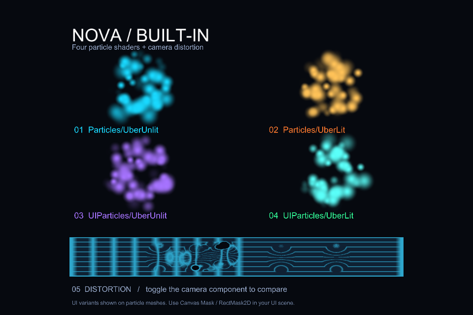

# ElderStarのデモシーン

**Docs** ([English](../../README.md), [日本語](../../README_JA.md)) | **Samples** ([English](../Samples/README.md), [日本語](../Samples/README_JA.md)) | **Demo** ([English](README.md), [日本語](README_JA.md))

## 概要

同梱の**Built-in Showcase**は、ElderStarの基本的な描画を確認できる再生可能なシーンです。
4色のパーティクルでParticle Uber Unlit/LitとUI Uber Unlit/Litを表示し、下の格子には動く歪みパーティクルを重ねています。
テクスチャとマテリアルも同梱しているため、追加のエフェクト素材やURPを導入せずに動かせます。

   
  Unity 2022.3.22f1での同梱シーン。配布パッケージの導入検証時に撮影。

## 使い方

1. Built-inプロジェクトへ[ElderStarを導入](../../README_JA.md#setup)します。
2. Package Managerから導入した場合は、ElderStarの**Samples**から**Built-in Showcase**をImportします。`Assets/Samples`以下に取り込まれたサンプルの`NovaShowcase.unity`を開きます。
3. `.unitypackage`から導入した場合は、`Assets/Nova/Samples/BuiltInShowcase/NovaShowcase.unity`を開きます。
4. 再生して、4つのパーティクル表示と下の格子の歪みを確認します。

シーンのカメラにある**Screen Space Distortion**を切り替えると、カメラ合成の歪みと歪みのない背景を比較できます。
このサンプルのUIシェーダーはパーティクルのメッシュに適用しています。実Canvasやそのマスクのデモではありません。
Canvasでの設定は[uGUIの説明](../../README_JA.md#ugui)を参照してください。

## 別のデモシーンを作る

**`Tools > ElderStar > Built-in > Create Showcase Scene`**から、新しい保存先を選択します。
未保存のシーンがあり、Unityから確認された場合は先に保存してください。既存のシーンやサンプル用アセットフォルダーは上書きしません。

このページはElderStarのBuilt-in用デモを紹介しています。バリアや氷などの作例は[Samples](../Samples/README_JA.md)を参照してください。
見た目はシーンの照明やカメラの入力にも依存します。検証範囲は[互換性と動作確認](../../README_JA.md#compatibility)に記載しています。
