# ElderStar: Multifunctional Particle Shaders for Built-in

[](LICENSE.md)
[](#requirements)
[](#requirements)

**Docs** ([English](README.md), [日本語](README_JA.md)) | **Samples** ([English](Documentation~/Samples/README.md), [日本語](Documentation~/Samples/README_JA.md)) | **Demo** ([English](Documentation~/Demo/README.md), [日本語](Documentation~/Demo/README_JA.md))

**ElderStar** is a collection of multifunctional Particle System shaders for Unity's Built-in Render Pipeline.
Based on [NOVA Shader](https://github.com/CyberAgentGameEntertainment/NovaShader) 3.6.0, it lets you use NOVA effects in Built-in projects and on VRChat PC avatars.

<p align="center">
  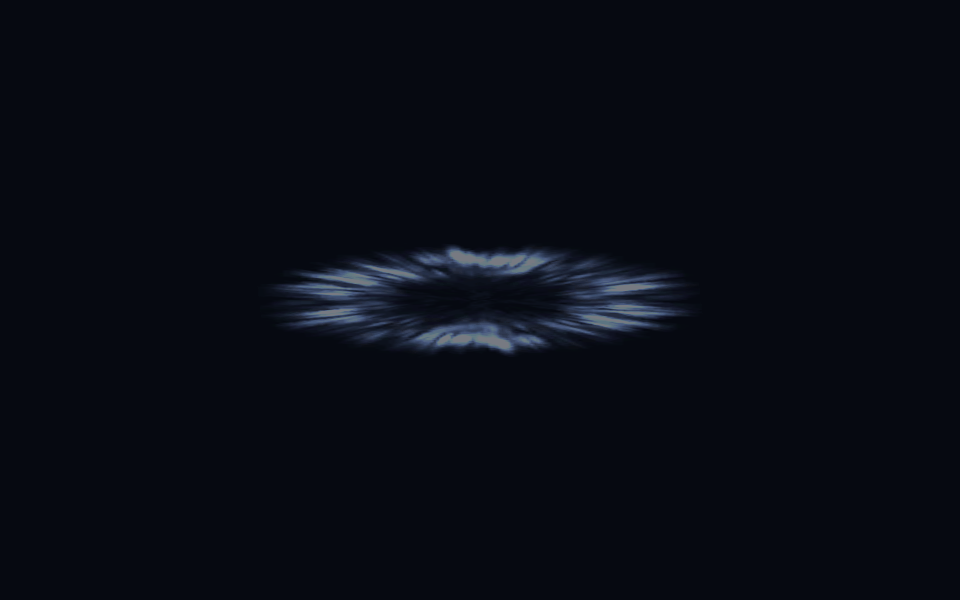<br>
  <sub>Barrier. Original NOVA sample assets rendered with ElderStar.</sub>
</p>
<p align="center">
  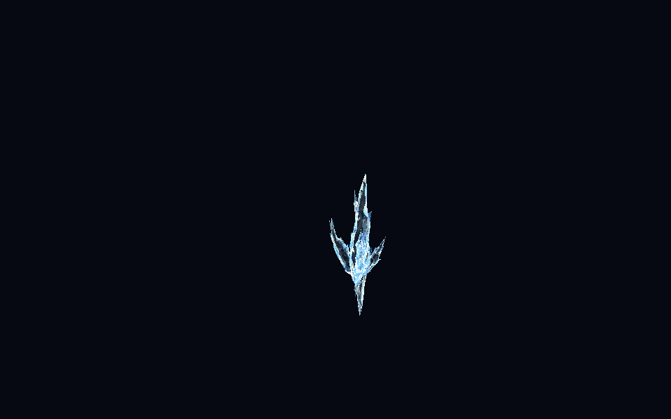<br>
  <sub>Ice. Sample effects by <a href="https://twitter.com/Ugokashiya">@Ugokashiya</a>, captured again in Built-in.</sub>
</p>

Combine Flow Maps, Flip Books, Dissolve, Fade, texture rotation, rim effects, Emission and Distortion to build particle effects.
The package includes Uber Lit for lit effects, Uber Unlit for unlit effects, uGUI shaders, Custom Data integration and an optimized shader generator.

**Materials and prefabs that reference NOVA's standard shaders can be used without converting assets or reassigning shaders.**
If a `.unitypackage` bundles the original NOVA implementation, select the original file through the [dedicated import menu](#nova-assets).

<p align="center">
  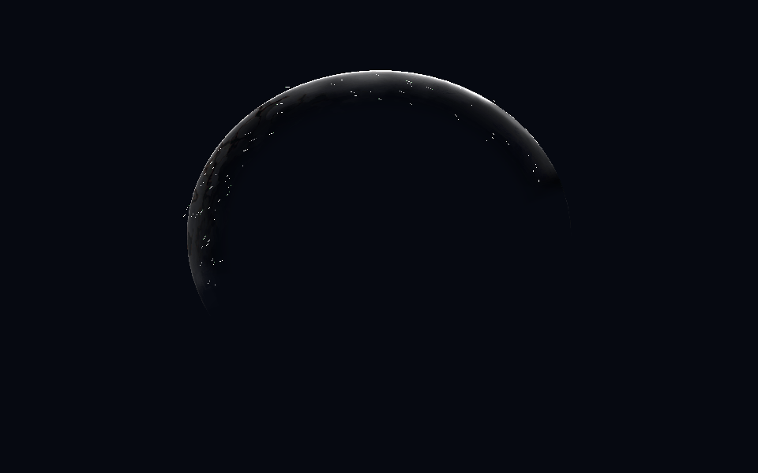
  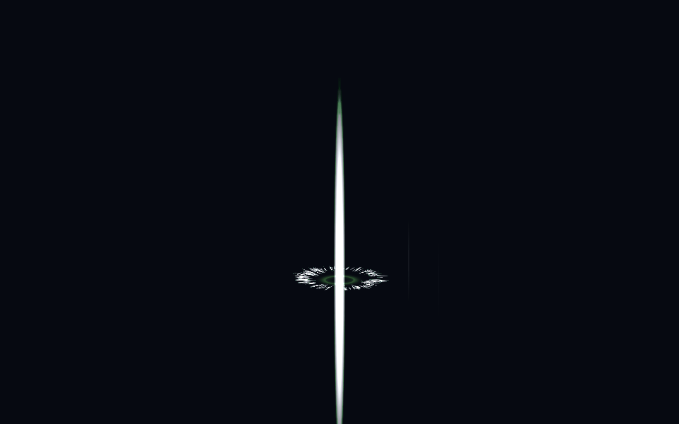<br>
  <sub>Slash and healing. Images and GIFs show actual ElderStar rendering. <a href="Documentation~/Images/README.md">Capture conditions and asset credits</a></sub>
</p>

Package ID: `me.smizuoch.elderstar` · Developed and maintained by [smizuoch](https://smizuoch.me)

## Table of Contents

<details>
<summary>Expand</summary>

- [Setup](#setup)
- [Using NOVA assets directly](#nova-assets)
- [Usage](#usage)
- [Uber Unlit Shader](#uber-unlit)
  - Render Settings / Vertex Deformation / Base Map / Tint Color
  - Flow Map / Parallax Map / Color Correction / Alpha Transition / Emission / Transparency
- [Uber Lit Shader](#uber-lit)
- [Distortion Shader](#distortion)
- [uGUI shaders](#ugui)
- [Casting shadows](#shadow-caster)
- [Custom Vertex Streams integration](#custom-data)
- [Mesh GPU Instancing](#gpu-instancing)
- [Automatic Custom Vertex Streams setup](#fix-now)
- [Removing unused references](#unused-references)
- [Optimized shaders](#optimization)
- [Built-in helpers](#builtin-helpers)
- [Compatibility and verification](#compatibility)
- [Editor API](#editor-api)
- [License](#license)

</details>

<a id="setup"></a>
## Setup

<a id="requirements"></a>
### Requirements

- Unity **2022.3 LTS or later**. Verified with 2022.3.22f1 / 6000.3.23f1.
- **Built-in Render Pipeline**. No URP or HDRP installation is required.
- Shader Model **3.5**; **4.5** for Mesh GPU Instancing.
- Verification covers Windows / Direct3D 11 and 12. VRChat support targets **PC avatars**.

Mirror Sampling requires Inline Sampler States. Texture2DArray and Texture3D require a compatible GPU and texture format.
For VRChat projects, use the Unity version specified by VCC / ALCOM and the VRChat SDK.

### Installation

**To install the `.unitypackage`**, download `ElderStar-0.1.8.unitypackage` from [GitHub Releases](https://github.com/smizuoch/ElderStar/releases), open it in Unity and click `Import`.
The implementation, documentation and samples are installed under `Assets/Nova`. This method also works for VRChat projects.

**To install with Package Manager**, use the following Git URL.

1. Open `Window > Package Manager`.
2. Select `+ > Add package from git URL...`.
3. Enter this URL:

```text
https://github.com/smizuoch/ElderStar.git?path=/Assets/Nova
```

The release also provides `me.smizuoch.elderstar-0.1.8.tgz`, which you can install with `+ > Add package from tarball...`.
The `.unitypackage` and Package Manager versions contain the same implementation; install one of them.

Append `#COMMIT_SHA` to the Git URL to pin a revision.
For a local checkout, choose `Add package from disk...` and select `Assets/Nova/package.json`.

Set the Render Pipeline Asset to `None` in Graphics settings and in each Quality level.
Do not install ElderStar alongside the original NOVA implementation. They share shader names, GUIDs and API names to preserve asset references.

<a id="nova-assets"></a>
## Using NOVA Assets Directly

Assets using NOVA 3.6.0's standard shaders retain their material settings, textures and prefab references.
To import an effect such as `Fire001.unitypackage`:

1. Install ElderStar.
2. Select **`Assets > Import Package > ElderStar Effect...`**.
3. Choose the original downloaded `.unitypackage` and click `Import` in Unity's dialog.
4. Place the imported prefab in your scene or as a child of your avatar.

This menu excludes the bundled original NOVA implementation and imports the effect assets without modifying them.
You do not need to create a converted package. Assets that do not include the NOVA implementation can also use Unity's regular import flow.

**If you double-click a package containing the original NOVA implementation, deselect that implementation's folders before importing.**
The importer does not convert URP-only scripts or custom shaders to Built-in.
Assets containing previously optimized shaders need those shaders regenerated with ElderStar.

<a id="usage"></a>
## Usage

### Create and assign a material

Create a material with `Create > Material`, then select a shader for your effect.
Shader names remain `Nova/...` to keep existing NOVA assets usable.

| Shader | Purpose |
| --- | --- |
| `Nova/Particles/UberUnlit` | Unlit fire, glow, magic and similar effects |
| `Nova/Particles/UberLit` | Meshes and particles that receive lighting |
| `Nova/Particles/Distortion` | Screen distortion, such as heat haze and shock waves |
| `Nova/UIParticles/UberUnlit` | Unlit effects for uGUI |
| `Nova/UIParticles/UberLit` | Lit effects for uGUI |

Assign the material in the Particle System's Renderer module, then adjust textures and colors in the Inspector.
If a vertex stream warning appears, use **Fix Now** at the bottom of the material Inspector to configure the required streams.

### Depth and distortion setup

**Distortion works without adding a camera script.**
In a regular Unity project, you can optionally add `ElderStar > Screen Space Distortion` to a camera for camera-wide composition.
It does not use a URP Renderer Feature.

**Soft Particles** require a camera depth texture.
In regular Unity projects, set `Camera.depthTextureMode |= DepthTextureMode.Depth` or use the camera component above.
**Depth Fade**, which fades by distance from the camera, does not require a scene depth texture.

On first installation, the original light intensity and color temperature settings are applied project-wide.
Subsequent manual changes are retained. To opt out of automatic setup, turn off
`Tools > ElderStar > Built-in > Automatic Initial Lighting Setup`.

### Use on VRChat PC avatars

Place your effect's Particle System or MeshRenderer on the avatar.
ElderStar's camera and Canvas helper components are not required on avatars.
Avatars cannot run arbitrary runtime C#, so use the shader-only rendering path.
Follow [VRChat's allowed component list](https://creators.vrchat.com/avatars/whitelisted-avatar-components/whitelisted-avatar-components/).

Soft Particles depend on the world's depth texture.
The viewer's [Safety settings](https://creators.vrchat.com/avatars/shader-fallback-system/) may replace custom shaders.
Use SDK validation and `Build & Test` to check your avatar, intended worlds and mirrors.

<a id="samples"></a>
### Run the sample

Import **Built-in Showcase** from ElderStar in Package Manager, open `NovaShowcase.unity` and press Play.
It demonstrates four particle variants and distortion.
With the `.unitypackage`, open `Assets/Nova/Samples/BuiltInShowcase/NovaShowcase.unity` directly.
You can also choose `Tools > ElderStar > Built-in > Create Showcase Scene` and select a destination for a new scene.

The effects at the top of this page use [upstream sample assets](https://github.com/CyberAgentGameEntertainment/NovaShader/tree/main/Assets/Samples) captured with ElderStar. They are separate from the bundled Showcase.

<a id="uber-unlit"></a>

## Uber Unlit Shader
The Uber Unlit shader is a multifunctional shader with no lighting applied.
Use this shader for particles that do not need lighting, such as glowing effects.

To use this shader, assign the `Nova/Particles/UberUnlit` shader to your material. The following is the description of each property that can be set from the Inspector.

#### Render Settings
The Render Settings control how the Material is rendered.

<p align="center">
  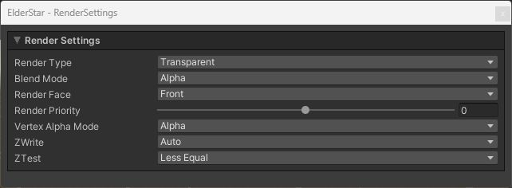<br>
  <sub>Render Settings</sub>
</p>


<table width="100%">
<thead>
<tr><td colspan="3"><b>Property Name</b></td><td><b>Description</b></td></tr>
</thead>
<tbody>
<tr><td colspan="3"><b>Render Type</b></td><td>
<p>
You can specify the type of rendering from the following options.
</p>
<p>
<ul>
<li>Opaque</li>
<li>Cutout</li>
<li>Transparent (Default)</li>
</ul>
</p>
<p>
If you select Cutout, the CutOff property will be displayed.
When Transparent is selected, the Blend Mode property will be displayed.
</p>
</td></tr>
<tr><td></td><td colspan=2><b>CutOff</b></td><td>
<p>
<b>This property is visible only when the Render Type is set to Cutout.</b>
</p>
<p>
Controls the threshold to clip semi-transparent areas.
The higher this value is, the more alpha will be cropped.
</p>
</td></tr>
<tr><td></td><td colspan=2><b>Blend Mode</b></td><td>
<p>
<b>This property is visible only when the Render Type is set to Transparent.</b>
</p>
<p>
You can specify the color blend method from the following options.
</p>
<p>
<ul>
<li>Alpha (Alpha Blending / Default)</li>
<li>Average</li>
<li>Multiply</li>
</ul>
</p>
</td></tr>
<tr><td colspan="3"><b>Render Face</b></td><td>
<p>
You can specify the rendering face from the following options.
</p>
<p>
<ul>
<li>Front (Default)</li>
<li>Back</li>
<li>Both</li>
</ul>
</p>
</td></tr>
<tr><td colspan="3"><b>Render Priority</b></td><td>
<p>
If the Render Type is the same, the one with the lower Render Priority will be drawn first.
</p>
</td></tr>
<tr><td colspan="3"><b>Vertex Alpha Mode</b></td><td>
<p>
You can specify how to use the alpha value of the vertex color from the following options.
</p>
<p>
<ul>
<li>Alpha: Use as alpha value (Default).</li>
<li>Transition Progress: Use as Progress in Alpha Transition function (see below).</li>
</ul>
</p>
</td></tr>
<tr><td colspan="3"><b>ZWrite</b></td><td>
<p>
You can set ZWrite value.
</p>
<p>
<ul>
<li>Auto: ZWrite is disabled when the Render Type is set to Transparent, and it is enabled when the Render Type is set to any other values.
</li>
<li>Off: ZWrite is always disabled.</li>
<li>On: ZWrite is always enabled.</li>
</ul>
</p>
</td></tr>
<tr><td colspan="3"><b>ZTest</b></td><td>
<p>
You can set ZTest value.
</p>
<p>
<ul>
<li>Disabled</li>
<li>Never</li>
<li>Less</li>
<li>Equal</li>
<li>Less Equal (Default)</li>
<li>Greater</li>
<li>Not Equal</li>
<li>Greater Equal</li>
<li>Always</li>
</ul>
</p>
</td></tr>
</tbody>
</table>

#### Vertex Deformation
With Vertex Deformation, you can control the deformation of vertices.

<p align="center">
  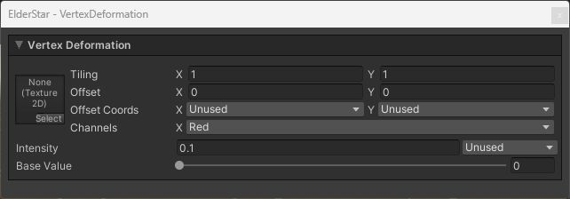<br>
  <sub>Vertex Deformation</sub>
</p>


<table width="100%">
<thead>
<tr><td colspan="3"><b>Property Name</b></td><td><b>Description</b></td></tr>
</thead>
<tbody>
<tr><td colspan="3"><b>Texture</b></td><td>
<p>
Sets the Vertex Deformation Map. The specifications are as follows.
</p>
<p>
<ul>
    <li>Push vertices in the normal direction of the object space based on the value of a single specified texture channel.</li>
    <li>You can select a channel by Channels property.</li>
    <li>Areas of the texture with a value of zero will not be pushed out, and areas with larger values will be pushed out more towards the exterior.</li>
</ul>
Note that you need to uncheck sRGB Color in the texture import setting because the pixels will be used as values, not colors.
</p>
</td></tr>
<tr><td colspan=3><b>Intensity</b></td><td>
<p>
Sets the Vertex Deformation intensity.
</p>
</td></tr>
<tr><td colspan=3><b>Base Value</b></td><td>
<p>
It is an offset applied to the values of the texture.<br>
Values lower than this will be pushed inward, while larger values will be pushed outward.
</p>
</tbody>
</table>

#### Base Map
Base Map controls the base color texture and its settings.

<p align="center">
  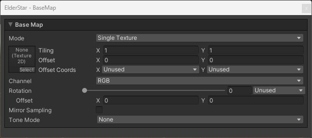<br>
  <sub>Base Map</sub>
</p>


<table width="100%">
<thead>
<tr><td colspan="3"><b>Property Name</b></td><td><b>Description</b></td></tr>
</thead>
<tbody>
<tr><td colspan="3"><b>Mode</b></td><td>
<p>
You can specify the type of the Base Map from the following options.
</p>
<p>
<ul>
<li>Single Texture: Use 2D texture (Default).</li>
<li>Flip Book: Use Flip-Book animation.</li>
<li>Flip Book Blending: Use Flip-Book animation with interpolated frames.</li>
</ul>
</p>
<p>
The required texture type will change depending on the mode you selected.<br>
Use the shader's Flip Book feature instead of the Particle System's Texture Sheet Animation.
</p>
</td></tr>
<tr><td colspan="3"><b>Texture</b></td><td>
<p>
Set the Base Map.
</p>
<p>
If you specify Flip Book as the Mode, you need to set <a href="https://docs.unity3d.com/2020.3/Documentation/Manual/class-Texture2DArray.html">Texture2DArray</a>.
And if you specify Flip Book Blending, you need to set <a href="https://docs.unity3d.com/2020.3/Documentation/Manual/class-Texture3D.html">Texture3D</a>.
</p>
</td></tr>
<tr><td colspan="3"><b>Channel</b></td><td>
<p>
Select which color channel from the Base Map to use for rendering. When a single channel is selected (Red/Green/Blue), the selected channel value is applied to RGB components while preserving the original alpha channel. Available options:
</p>
<p>
<ul>
<li>RGB: Use all color channels as-is (Default)</li>
<li>Red: Convert red channel to grayscale</li>
<li>Green: Convert green channel to grayscale</li>
<li>Blue: Convert blue channel to grayscale</li>
</ul>
</td></tr>
<tr><td colspan="3"><b>Rotation</b></td><td>
<p>
Set the amount of rotation of the Base Map.
</p>
</td></tr>
<tr><td></td><td colspan=2><b>Offset</b></td><td>
<p>
Shifts the center coordinate of rotation.
</p>
</td></tr>
<tr><td colspan="3"><b>Mirror Sampling</b></td><td>
<p>
If true, mirrors the texture to create a repeating pattern.
</p>
</td></tr>
<tr><td colspan="3"><b>Flip-Book Progress</b></td><td>
<p>
<b>This property is visible only when the Mode is set to Flip Book or Flip Book Blending.</b>
</p>
<p>
The progress of the Flip-Book or Flip-Book Blending.
</p>
</td></tr>
<tr><td colspan="3"><b>Random Row Selection</b></td><td>
<p>
<b>This property is visible only when the Mode is set to Flip Book or Flip Book Blending.</b>
</p>
<p>
Equivalent to Unity's Texture Sheet Animation Row Mode > Random functionality. When enabled, each particle randomly selects and maintains one row throughout its lifetime for animation playback.
</p>
<p>
Uses Unity Particle System's Custom Coord for random value input. First set Row Count to match the number of rows in your texture sheet, then configure any Custom Coord channel in "Random Between Two Constants" mode (range: 0 to Row Count) and assign it.
</p>
</td></tr>
<tr><td></td><td colspan=2><b>Row Count</b></td><td>
<p>
<b>This property is visible only when Random Row Selection is enabled.</b>
</p>
<p>
Set the number of rows in your texture sheet (e.g., for a 4×4 texture sheet, set Row Count to 4).
</p>
</td></tr>
<tr><td></td><td colspan=2><b>Random Coord</b></td><td>
<p>
<b>This property is visible only when Random Row Selection is enabled.</b>
</p>
<p>
Select the Custom Coord channel for random value input. This should correspond to the Custom Data channel configured in Unity Particle System with "Random Between Two Constants" mode.
</p>
</td></tr>
<tr><td colspan="3"><b>Tone Mode</b></td><td>
<p>
Controls tone mapping for color adjustment based on luminance values. Select from the following options:
</p>
<p>
<ul>
<li><b>None:</b> No tone mapping applied (Default).</li>
<li><b>Tritone:</b> Three-tone mapping with Highlights, Midtones, and Shadows control.</li>
<li><b>Pentone:</b> Five-tone mapping with Highlights, Brights, Midtones, Darktones, and Shadows control.</li>
</ul>
</p>
<p>
Boundary values determine the thresholds between regions, mapping them to the configured colors.
Colors between each boundary are linearly interpolated, applying smooth tone mapping.
Note that this linear interpolation is performed in the shader, so you need to consider your project's color space when setting parameters.
</p>
</td></tr>
<tr><td></td><td colspan=2><b>Tone Channel</b></td><td>
<p>
<b>This property is visible when Tone Mode is not None.</b>
</p>
<p>
Selects which color channel to use for luminance calculation in tone mapping. Choose from Red, Green, Blue, or Alpha (default).
</p>
</td></tr>
<tr><td></td><td colspan=2><b>Highlights Color</b></td><td>
<p>
<b>This property is visible when Tone Mode is Tritone or Pentone.</b>
</p>
<p>
Sets the color applied to highlight regions.
</p>
</td></tr>
<tr><td></td><td colspan=2><b>Brights Color</b></td><td>
<p>
<b>This property is visible only when Tone Mode is Pentone.</b>
</p>
<p>
Sets the color applied to brights regions (between highlights and midtones).
</p>
</td></tr>
<tr><td></td><td colspan=2><b>Midtones Color</b></td><td>
<p>
<b>This property is visible when Tone Mode is Tritone or Pentone.</b>
</p>
<p>
Sets the color applied to midtone regions.
</p>
</td></tr>
<tr><td></td><td colspan=2><b>Darktones Color</b></td><td>
<p>
<b>This property is visible only when Tone Mode is Pentone.</b>
</p>
<p>
Sets the color applied to darktones regions (between midtones and shadows).
</p>
</td></tr>
<tr><td></td><td colspan=2><b>Shadows Color</b></td><td>
<p>
<b>This property is visible when Tone Mode is Tritone or Pentone.</b>
</p>
<p>
Sets the color applied to shadow regions.
</p>
</td></tr>
<tr><td></td><td colspan=2><b>Highlights</b></td><td>
<p>
<b>This property is visible when Tone Mode is Tritone or Pentone.</b>
</p>
<p>
Sets the luminance boundary value for highlights.
</p>
</td></tr>
<tr><td></td><td colspan=2><b>Brights</b></td><td>
<p>
<b>This property is visible only when Tone Mode is Pentone.</b>
</p>
<p>
Controls the position of the brights boundary between midtones and highlights.
</p>
</td></tr>
<tr><td></td><td colspan=2><b>Midtones</b></td><td>
<p>
<b>This property is visible when Tone Mode is Tritone or Pentone.</b>
</p>
<p>
Controls the balance between tonal regions by determining the midpoint position between shadows and highlights.
</p>
</td></tr>
<tr><td></td><td colspan=2><b>Darktones</b></td><td>
<p>
<b>This property is visible only when Tone Mode is Pentone.</b>
</p>
<p>
Controls the position of the darktones boundary between shadows and midtones.
</p>
</td></tr>
<tr><td></td><td colspan=2><b>Shadows</b></td><td>
<p>
<b>This property is visible when Tone Mode is Tritone or Pentone.</b>
</p>
<p>
Sets the luminance boundary value for shadows.
</p>
</td></tr>
</tbody>
</table>

#### Tint Color
Tint Color controls the color to be multiplied.

<p align="center">
  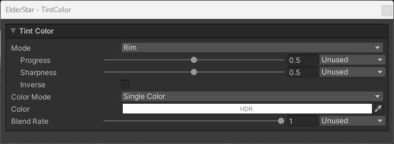<br>
  <sub>Tint Color</sub>
</p>


<table width="100%">
<thead>
<tr><td colspan="3"><b>Property Name</b></td><td><b>Description</b></td></tr>
</thead>
<tbody>
<tr><td colspan="3"><b>Mode</b></td><td>
<p>
You can specify the area to apply the Tint Color from the following options.
</p>
<p>
<ul>
<li>None: Disable the Tint Color (Default).</li>
<li>All: Apply to the entire surface.</li>
<li>Rim: Apply to the rim.</li>
</ul>
</p>
</td></tr>
<tr><td></td><td colspan=2><b>Progress</b></td><td>
<p>
<b>This property is visible only when the Mode is set to Rim.</b>
</p>
<p>
The larger this value is, the more only the areas near the edges will be colored.
</p>
</td></tr>
<tr><td></td><td colspan=2><b>Sharpness</b></td><td>
<p>
<b>This property is visible only when the Mode is set to Rim.</b>
</p>
<p>
The larger this value is, the sharper the edge of the rim will be.
</p>
</td></tr>
<tr><td></td><td colspan=2><b>Inverse</b></td><td>
<p>
<b>This property is visible only when the Mode is set to Rim.</b>
</p>
<p>
If checked, reverse the range of the rim.
</p>
</td></tr>
<tr><td colspan="3"><b>Color Mode</b></td><td>
<p>
You can specify how you set the Tint Color.
</p>
<p>
<ul>
<li>Single Color: Single Color (Default).</li>
<li>Single Texture: Specified by the texture.</li>
<li>Flip Book: Use Flip-Book animation.</li>
<li>Flip Book Blending: Use Flip-Book animation with interpolated frames.</li>
</ul>
</p>
<p>
The required texture type will change depending on the mode you selected.
</p>
</td></tr>
<tr><td colspan=3><b>Color</b></td><td>
<p>
<b>This property is visible only when the Color Mode is set to Single Color.</b>
</p>
<p>
The color to be multiplied.
</p>
</td></tr>
<tr><td colspan=3><b>Texture</b></td><td>
<p>
<b>This property is visible only when the Color Mode is set to Single Texture, Flip Book, or Flip Book Blending.</b>
</p>
<p>
The texture whose color will be multiplied.
</p>
<p>
If you specify Flip Book as the Color Mode, you need to set <a href="https://docs.unity3d.com/2020.3/Documentation/Manual/class-Texture2DArray.html">Texture2DArray</a>.
And if you specify Flip Book Blending, you need to set <a href="https://docs.unity3d.com/2020.3/Documentation/Manual/class-Texture3D.html">Texture3D</a>.
</p>
</td></tr>
<tr><td colspan="3"><b>Rotation</b></td><td>
<p>
<b>This property is visible only when the Color Mode is set to Single Texture, Flip Book, or Flip Book Blending.</b>
</p>
<p>
Set the amount of rotation of the Tint Map.
</p>
</td></tr>
<tr><td></td><td colspan=2><b>Offset</b></td><td>
<p>
Shifts the center coordinate of rotation.
</p>
</td></tr>
<tr><td colspan=3><b>Flip-Book Progress</b></td><td>
<p>
<b>This property is visible only when the Color Mode is set to Flip Book or Flip Book Blending.</b>
</p>
<p>
The progress of the Flip-Book or Flip-Book Blending.
</p>
</td></tr>
<tr><td colspan=3><b>Blend Rate</b></td><td>
<p>
The color multiplication factor.
If this value is zero, the color will not be applied; if it is one, the color will be multiplied as is.
</p>
</td></tr>
<tr><td colspan="3"><b>Random Row Selection</b></td><td>
<p>
<b>This property is visible only when the Color Mode is set to Flip Book or Flip Book Blending.</b>
</p>
<p>
Equivalent to Unity's Texture Sheet Animation Row Mode > Random functionality. When enabled, each particle randomly selects and maintains one row throughout its lifetime for animation playback.
</p>
<p>
Uses Unity Particle System's Custom Coord for random value input. First set Row Count to match the number of rows in your texture sheet, then configure any Custom Coord channel in "Random Between Two Constants" mode (range: 0 to Row Count) and assign it.
</p>
</td></tr>
<tr><td></td><td colspan=2><b>Row Count</b></td><td>
<p>
<b>This property is visible only when Random Row Selection is enabled.</b>
</p>
<p>
Set the number of rows in your texture sheet (e.g., for a 4×4 texture sheet, set Row Count to 4).
</p>
</td></tr>
<tr><td></td><td colspan=2><b>Random Coord</b></td><td>
<p>
<b>This property is visible only when Random Row Selection is enabled.</b>
</p>
<p>
Select the Custom Coord channel for random value input. This should correspond to the Custom Data channel configured in Unity Particle System with "Random Between Two Constants" mode.
</p>
</td></tr>
</tbody>
</table>

#### Flow Map
You can use the Flow Map to distort the Base Map to the specified directions.

<p align="center">
  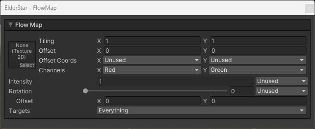<br>
  <sub>Flow Map</sub>
</p>


<table width="100%">
<thead>
<tr><td colspan="3"><b>Property Name</b></td><td><b>Description</b></td></tr>
</thead>
<tbody>
<tr><td colspan="3"><b>Texture</b></td><td>
<p>
Sets the Flow Map. The specifications are as follows.
</p>
<p>
<ul>
    <li>Shifts the UV values of the Base Map based on the texture color channels.</li>
    <li>The color channels used is determined by the X value and Y value of the Channels properties.</li>
    <li>The smaller the value from 0.5, the more the UV value shifts in the negative direction, and vice versa.</li>
</ul>
Note that you need to uncheck sRGB Color in the texture import setting because the pixels will be used as values, not colors.
</p>
</td></tr>
<tr><td colspan="3"><b>Rotation</b></td><td>
<p>
Set the amount of rotation of the Flow Map.
</p>
</td></tr>
<tr><td></td><td colspan=2><b>Offset</b></td><td>
<p>
Shifts the center coordinate of rotation.
</p>
</td></tr>
<tr><td colspan=3><b>Intensity</b></td><td>
<p>
Sets the Flow Map intensity.
</p>
</td></tr>
<tr><td colspan=3><b>Targets</b></td><td>
<p>
Set the targets to which the flow map will be applied (multiple selections are possible).

* Base Map
* Tint Map
* Alpha Transition Map
* Emission Map
</p>
</td></tr>
</tbody>
</table>

#### Parallax Map
Parallax Map can create a parallax effect.

<p align="center">
  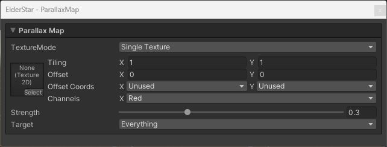<br>
  <sub>Parallax Map</sub>
</p>

<table width="100%">
<thead>
<tr><td colspan="3"><b>Property Name</b></td><td><b>Description</b></td></tr>
</thead>
<tbody>
<tr><td colspan="3"><b>Mode</b></td><td>
<p>
Specifies the mode of the parallax map from the following options:
</p>
<p>
<ul>
<li>Single Texture: Regular 2D texture (default)</li>
<li>Flip Book: Flip-Book animation</li>
<li>Flip Book Blending: Flip-Book animation with blending</li>
</ul>
</p>
<p>
The texture type changes depending on the selected mode.
</p>
</td></tr>
<tr><td colspan="3"><b>Texture</b></td><td>
<p>
Sets the parallax map.<br>
</p>
<p>
If Flip Book is selected in Mode, a <a href="https://docs.unity3d.com/2020.3/Documentation/Manual/class-Texture2DArray.html">Texture2DArray</a> needs to be set.<br>
If Flip Book Blending is selected in Mode, a <a href="https://docs.unity3d.com/2020.3/Documentation/Manual/class-Texture3D.html">Texture3D</a> needs to be set.<br>
</p>
The specifications of the parallax map are as follows:
<p>
<ul>
<li>Changes the surface's concavity based on the color value of the specified channel</li>
<li>The value of 0 is the original state, and the closer it gets to 1, the more concave it becomes</li>
</ul>
Since a texture is used as a value, not a color, be sure to uncheck the sRGB Color checkbox in the texture settings.
</p>
</td></tr>
<tr><td colspan="3"><b>Flip-Book Progress</b></td><td>
<p>
<b>This property is visible only when the Mode is set to Flip Book or Flip Book Blending.</b>
</p>
<p>
The progress of the Flip-Book or Flip-Book Blending.
</p>
</td></tr>
<tr><td colspan="3"><b>Random Row Selection</b></td><td>
<p>
<b>This property is visible only when the Mode is set to Flip Book or Flip Book Blending.</b>
</p>
<p>
Equivalent to Unity's Texture Sheet Animation Row Mode > Random functionality. When enabled, each particle randomly selects and maintains one row throughout its lifetime for animation playback.
</p>
<p>
Uses Unity Particle System's Custom Coord for random value input. First set Row Count to match the number of rows in your texture sheet, then configure any Custom Coord channel in "Random Between Two Constants" mode (range: 0 to Row Count) and assign it.
</p>
</td></tr>
<tr><td></td><td colspan=2><b>Row Count</b></td><td>
<p>
<b>This property is visible only when Random Row Selection is enabled.</b>
</p>
<p>
Set the number of rows in your texture sheet (e.g., for a 4×4 texture sheet, set Row Count to 4).
</p>
</td></tr>
<tr><td></td><td colspan=2><b>Random Coord</b></td><td>
<p>
<b>This property is visible only when Random Row Selection is enabled.</b>
</p>
<p>
Select the Custom Coord channel for random value input. This should correspond to the Custom Data channel configured in Unity Particle System with "Random Between Two Constants" mode.
</p>
</td></tr>
<tr><td colspan=3><b>Strength</b></td><td>
<p>
Sets the strength of the parallax map when applied.
</p>
</td></tr>
<tr><td colspan=3><b>Targets</b></td><td>
<p>
Sets the targets to apply the parallax map (multiple selection possible).
<ul>
<li>Base Map</li>
<li>Tint Map</li>
<li>Emission Map</li>
</ul>
</p>
</td></tr>
</tbody>
</table>

#### Color Correction
Color Correction correct the colors up to this point.

<p align="center">
  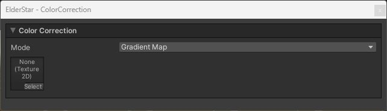<br>
  <sub>Color Correction</sub>
</p>


<table width="100%">
<thead>
<tr><td colspan="3"><b>Property Name</b></td><td><b>Description</b></td></tr>
</thead>
<tbody>
<tr><td colspan="3"><b>Mode</b></td><td>
<p>
You can specify how to correct the colors.
</p>
<p>
<ul>
<li>None: Disable the Color Correction (Default).</li>
<li>Greyscale: Chage the colors to greyscale.</li>
<li>Gradient Map: Use the gradient map.</li>
</ul>
</p>
</td></tr>
<tr><td><td colspan=2><b>Texture</b></td><td>
<p>
<b>This property is visible only when the Mode is set to Gradient.</b>
</p>
<p>
Sets the Gradient Map. The specifications are as follows.
<ul>
<li>Replace the luminance with the colors of the gradient map.</li>
<li>Change the U value for sampling the gradient map according to luminance.</li>
<li>When luminance is at maximum, the right edge of the gradient map is sampled.</li>
<li>Therefore, we need to use a texture with a horizontal gradient.</li>
</ul>
</p>
</td></tr>
</tbody>
</table>

#### Alpha Transition
Alpha Transition controls the alpha value using a texture.

<p align="center">
  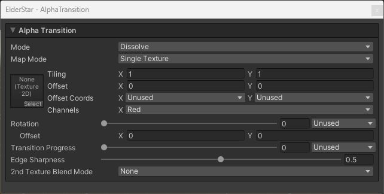<br>
  <sub>Alpha Transition</sub>
</p>


<table width="100%">
<thead>
<tr><td colspan="3"><b>Property Name</b></td><td><b>Description</b></td></tr>
</thead>
<tbody>
<tr><td colspan="3"><b>Mode</b></td><td>
<p>
You can specify Alpha Transition Mode from the following options.
</p>
<p>
<ul>
<li>None: Disable the Alpha Transition (Default).</li>
<li>Fade: Transition using the fade texture.</li>
<li>Dissolve: Transition using the dissolve texture.</li>
</ul>
</p>
</td></tr>
<td colspan=3><b>Map Mode</b></td><td>
<p>
You can specify the type of the Alpha Transition Map from the following options.
</p>
<p>
<ul>
<li>Single Texture: Use 2D texture (Default).</li>
<li>Flip Book: Use Flip-Book animation.</li>
<li>Flip Book Blending: Use Flip-Book animation with interpolated frames.</li>
</ul>
</p>
<p>
The required texture type will change depending on the mode you selected.
</p>
</td></tr>
<tr><td colspan="3"><b>Texture</b></td><td>
<p>
Sets the Alpha Transition Map. The specifications are as follows.
<ul>
    <li>Changes the alpha value based on the texture color channel.</li>
    <li>The color channels used is determined by the X value of the Channels properties.</li>
    <li>The smaller the R value, the easier it is to disappear, and vice versa.</li>
</ul>
</p>
<p>
If you specify Flip Book as the Mode, you need to set <a href="https://docs.unity3d.com/2020.3/Documentation/Manual/class-Texture2DArray.html">Texture2DArray</a>.
And if you specify Flip Book Blending, you need to set <a href="https://docs.unity3d.com/2020.3/Documentation/Manual/class-Texture3D.html">Texture3D</a>.
</p>
<p>
Note that you need to uncheck sRGB Color in the texture import setting because the pixels will be used as values, not colors.
</p>
</td></tr>
<tr><td colspan="3"><b>Rotation</b></td><td>
<p>
Set the amount of rotation of the Alpha Transition Map.
</p>
</td></tr>
<tr><td></td><td colspan=2><b>Offset</b></td><td>
<p>
Shifts the center coordinate of rotation.
</p>
</td></tr>
<tr><td colspan="3"><b>Flip-Book Progress</b></td><td>
<p>
<b>This property is visible only when the Map Mode is set to Flip Book or Flip Book Blending.</b>
</p>
<p>
Sets the progress of Flip-Book or Flip-Book Blending.
</p>
</td></tr>
<tr><td colspan="3"><b>Random Row Selection</b></td><td>
<p>
<b>This property is visible only when the Map Mode is set to Flip Book or Flip Book Blending.</b>
</p>
<p>
Equivalent to Unity's Texture Sheet Animation Row Mode > Random functionality. When enabled, each particle randomly selects and maintains one row throughout its lifetime for animation playback.
</p>
<p>
Uses Unity Particle System's Custom Coord for random value input. First set Row Count to match the number of rows in your texture sheet, then configure any Custom Coord channel in "Random Between Two Constants" mode (range: 0 to Row Count) and assign it.
</p>
</td></tr>
<tr><td></td><td colspan=2><b>Row Count</b></td><td>
<p>
<b>This property is visible only when Random Row Selection is enabled.</b>
</p>
<p>
Set the number of rows in your texture sheet (e.g., for a 4×4 texture sheet, set Row Count to 4).
</p>
</td></tr>
<tr><td></td><td colspan=2><b>Random Coord</b></td><td>
<p>
<b>This property is visible only when Random Row Selection is enabled.</b>
</p>
<p>
Select the Custom Coord channel for random value input. This should correspond to the Custom Data channel configured in Unity Particle System with "Random Between Two Constants" mode.
</p>
</td></tr>
<tr><td colspan="3"><b>Transition Progress</b></td><td>
<p>
Sets the progress of Transition.
</p>
</td></tr>
<tr><td colspan="3"><b>2nd Texture Blend Mode</b></td><td>
<p>
You can specify how to composite the second texture from the following options.
</p>
<p>
<ul>
<li>None: Don't use The second texture (Default).</li>
<li>Additive: Referring to the average of two textures.</li>
<li>Multiply</li>
</ul>
</p>
</td></tr>
<tr><td colspan="3"><b>2nd Texture Map Mode</b></td><td>
<p>
<b>This property is visible only when 2nd Texture Blend Mode is set to Average or Multiply.</b>
</p>
<p>
You can specify the Map Mode of the second Alpha Transition Map independently from the first texture. The following options are available.
</p>
<p>
<ul>
<li>Single Texture: Use 2D texture (Default).</li>
<li>Flip Book: Use Flip-Book animation.</li>
<li>Flip Book Blending: Use Flip-Book animation with interpolated frames.</li>
</ul>
</p>
<p>
The required texture type will change depending on the mode you selected.
</p>
</td></tr>
<tr><td colspan="3"><b>2nd Texture Rotation</b></td><td>
<p>
<b>This property is visible only when 2nd Texture Blend Mode is set to Average or Multiply.</b>
</p>
<p>
Set the amount of rotation of the second Alpha Transition Map.
</p>
</td></tr>
<tr><td></td><td colspan=2><b>Offset</b></td><td>
<p>
Shifts the center coordinate of rotation.
</p>
</td></tr>
<tr><td colspan="3"><b>Edge Sharpness</b></td><td>
<p>
<b>This property is visible only when the Mode is set to Dissolve.</b>
</p>
<p>
Sets the sharpness of the edge.
</p>
</td></tr>
</tbody>
</table>

#### Emission
The Emission control how the particles are glowing.

<p align="center">
  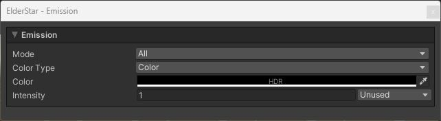<br>
  <sub>Emission</sub>
</p>


<table width="100%">
<thead>
<tr><td colspan="3"><b>Property Name</b></td><td><b>Description</b></td></tr>
</thead>
<tbody>
<tr><td colspan="3"><b>Mode</b></td><td>
<p>
You can specify the area to be glowed.
</p>
<p>
<ul>
<li>None: Disable the Emission (Default).</li>
<li>All: The entire surface will glow.</li>
<li>By Texture: The area specified by the texture will glow.</li>
<li>Edge: Edges (areas where alpha is greater than 0 and less than 1) will glow.</li>
</ul>
</p>
</td></tr>
<td colspan=3><b>Map Mode</b></td><td>
<p>
<b>This property is visible only when the Mode is set to By Texture.</b>
</p>
<p>
You can specify the Mode of the Emission Map from the following options.
</p>
<p>
<ul>
<li>Single Texture: Use 2D texture (Default).</li>
<li>Flip Book: Use Flip-Book animation.</li>
<li>Flip Book Blending: Use Flip-Book animation with interpolated frames.</li>
</ul>
</p>
<p>
The required texture type will change depending on the mode you selected.
</p>
</td></tr>
<tr><td colspan="3"><b>Texture</b></td><td>
<p>
<b>This property is visible only when the Mode is set to By Texture.</b>
</p>
<p>
Sets the Emission Map. The specifications are as follows.
<ul>
    <li>The larger the texture color channels value, the more likely it is to glow.</li>
    <li>The color channels used is determined by the X value of the Channels property.</li>
</ul>
</p>
<p>
If you specify Flip Book as the Mode, you need to set <a href="https://docs.unity3d.com/2020.3/Documentation/Manual/class-Texture2DArray.html">Texture2DArray</a>.
And if you specify Flip Book Blending, you need to set <a href="https://docs.unity3d.com/2020.3/Documentation/Manual/class-Texture3D.html">Texture3D</a>.
</p>
<p>
Note that you need to uncheck sRGB Color in the texture import setting because the pixels will be used as values, not colors.
</p>
</td></tr>
<tr><td colspan="3"><b>Rotation</b></td><td>
<p>
<b>This property is visible only when the Mode is set to By Texture.</b>
</p>
<p>
Set the amount of rotation of the Emission Map.
</p>
</td></tr>
<tr><td></td><td colspan=2><b>Offset</b></td><td>
<p>
Shifts the center coordinate of rotation.
</p>
</td></tr>
<tr><td colspan="3"><b>Flip-Book Progress</b></td><td>
<p>
<b>This property is visible only when the Mode is set to By Texture and the Map Mode is set to Flip Book or Flip Book Blending.</b>
</p>
<p>
Sets the progress of Flip-Book or Flip-Book Blending.
</p>
</td></tr>
<tr><td colspan="3"><b>Random Row Selection</b></td><td>
<p>
<b>This property is visible only when the Mode is set to By Texture and the Map Mode is set to Flip Book or Flip Book Blending.</b>
</p>
<p>
Equivalent to Unity's Texture Sheet Animation Row Mode > Random functionality. When enabled, each particle randomly selects and maintains one row throughout its lifetime for animation playback.
</p>
<p>
Uses Unity Particle System's Custom Coord for random value input. First set Row Count to match the number of rows in your texture sheet, then configure any Custom Coord channel in "Random Between Two Constants" mode (range: 0 to Row Count) and assign it.
</p>
</td></tr>
<tr><td></td><td colspan=2><b>Row Count</b></td><td>
<p>
<b>This property is visible only when Random Row Selection is enabled.</b>
</p>
<p>
Set the number of rows in your texture sheet (e.g., for a 4×4 texture sheet, set Row Count to 4).
</p>
</td></tr>
<tr><td></td><td colspan=2><b>Random Coord</b></td><td>
<p>
<b>This property is visible only when Random Row Selection is enabled.</b>
</p>
<p>
Select the Custom Coord channel for random value input. This should correspond to the Custom Data channel configured in Unity Particle System with "Random Between Two Constants" mode.
</p>
</td></tr>
<tr><td colspan="3"><b>Color Type</b></td><td>
<p>
You can specify the type of the emission color from the following options.
<ul>
<li>Color: Use the specified single color as the emission color.</li>
<li>Base Color: Use the RGB values up to this point as the emission color.</li>
<li>Gradient Map: Use a gradient map to specify the emission color.</li>
</ul>
Gradient Map can only be selected when Mode is set to By Texture or Edge.
</p>
</td></tr>
<tr><td colspan="3"><b>Color</b></td><td>
<p>
<b>This property is visible only when the Color Type is set to Color.</b>
</p>
<p>
Sets the emission color as HDR color.
</p>
</td></tr>
<tr><td colspan="3"><b>Keep Edge Transparency</b></td><td>
<p>
<b>This property is visible only when the Mode is set to Edge.</b>
</p>
<p>
If checked, the edges will not be transparent.
</p>
</td></tr>
<tr><td colspan="3"><b>Gradient Map</b></td><td>
<p>
<b>This property is visible only when the Color Type is set to Gradient Map.</b>
</p>
<p>
Sets the Gradient Map. The specifications are as follows.
<ul>
<li>When Mode is By Texture: Sampling the R value of the Emission Map as the U value of the Gradient Map.</li>
<li>When Mode is Edge: Sample alpha values as U values of the Gradient Map.</li>
<li>You need to use a texture with a horizontal gradient as the Gradient Map.</li>
</ul>
</p>
</td></tr>
<tr><td colspan="3"><b>Intensity</b></td><td>
<p>
Sets the intensity of the emission.
</p>
</td></tr>
</tbody>
</table>

#### Transparency
Control the transparency in various ways.

<p align="center">
  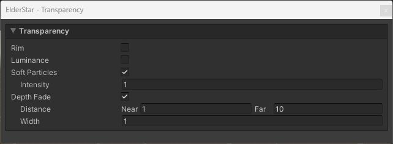<br>
  <sub>Transparency</sub>
</p>


<table width="100%">
<thead>
<tr><td colspan="3"><b>Property Name</b></td><td><b>Description</b></td></tr>
</thead>
<tbody>
<tr><td colspan="3"><b>Rim</b></td><td>
<p>
If checked, the rim will be transparent.
</p>
</td></tr>
<tr><td></td><td colspan="2"><b>Progress</b></td><td>
<p>
Sets the progress of transparency.
</p>
</td></tr>
<tr><td></td><td colspan="2"><b>Sharpness</b></td><td>
<p>
The larger this value is, the sharper the edge will be.
</p>
</td></tr>
<tr><td></td><td colspan="2"><b>Inverse</b></td><td>
<p>
Inverse the transparency area.
</p>
</td></tr>
<tr><td colspan="3"><b>Luminance</b></td><td>
<p>
If checked, areas with low brightness will be transparent.
</p>
</td></tr>
<tr><td></td><td colspan="2"><b>Progress</b></td><td>
<p>
Sets the progress of transparency.
</p>
</td></tr>
<tr><td></td><td colspan="2"><b>Sharpness</b></td><td>
<p>
The larger this value is, the sharper the edge will be.
</p>
</td></tr>
<tr><td></td><td colspan="2"><b>Inverse</b></td><td>
<p>
Inverse the transparency area.
</p>
</td></tr>
<tr><td colspan="3"><b>Soft Particles</b></td><td>
<p>
If checked, soft particles will be enabled.
This feature requires a camera depth texture. On VRChat avatars, availability depends on the world.
</p>
</td></tr>
<tr><td></td><td colspan="2"><b>Intensity</b></td><td>
<p>
The larger this value, the larger the transparent area.
</p>
</td></tr>
<tr><td colspan="3"><b>Depth Fade</b></td><td>
<p>
Makes the areas near and far from the camera transparent.
This feature uses distance from the camera and does not require a scene depth texture.
</p>
</td></tr>
<tr><td></td><td colspan="2"><b>Distance</b></td><td>
<p>
Set the transparency range.
The area closer than Near and farther than Far from the camera will be transparent.
</p>
</td></tr>
<tr><td></td><td colspan="2"><b>Width</b></td><td>
<p>
The distance from the beginning of transparency to the end of complete transparency.
</p>
</td></tr>
</tbody>
</table>

<a id="uber-lit"></a>
## Uber Lit Shader
The Uber Lit shader is a multifunctional shader with lighting applied. Use this shader for particles that need lighting, such as mesh effects.
This shader uses NOVA's PBR material controls with Built-in lights, shadows and probes.

To use this shader, assign the `Nova/Particles/UberLit` shader to your material.
This shader is based on the Uber Unlit shader with additional processing and properties.

The description of the added properties is as follows.


#### Render Settings
The following lighting properties are added to Render Settings.

<p align="center">
  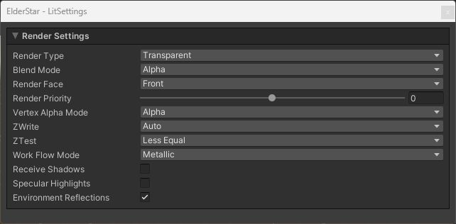<br>
  <sub>Lit Settings</sub>
</p>


<table width="100%">
<thead>
<tr><td colspan="3"><b>Property Name</b></td><td><b>Description</b></td></tr>
</thead>
<tbody>
<tr><td colspan="3"><b>Work Flow Mode</b></td><td>
<p>
You can specify the mode of PBR workflow from the following options.<br>
</p>
<p>
<ul>
<li>Specular</li>
<li>Metallic</li>
</ul>
</p>
For more information on workflow, please refer to the following URL
https://docs.unity3d.com/2018.4/Documentation/Manual/StandardShaderMetallicVsSpecular.html
https://docs.unity3d.com/2018.4/Documentation/Manual/StandardShaderMaterialParameterSpecular.html
https://docs.unity3d.com/2018.4/Documentation/Manual/StandardShaderMaterialParameterMetallic.html
<tr><td colspan="3"><b>Receive Shadows</b></td><td>
<p>
Enables receiving shadows from Built-in lights. Configure shadows on the light and in Quality settings.<br>
</p>
<tr><td colspan="3"><b>Specular Highlights</b></td><td>
<p>
If checking the box, it will be enabled specular highlighting.<br>
</p>
<tr><td colspan="3"><b>Environment Reflections</b></td><td>
<p>
If checking the box, it will be affected ambient light from the Reflection Probe and Skybox.<br>
For more information on the effects of ambient light, please refer to "Environment Reflection" at the following URL.<br>
https://docs.unity3d.com/2018.4/Documentation/Manual/GlobalIllumination.html
</p>
</tbody>
</table>

#### Surface Maps
Several surface properties have been added for lighting.

<p align="center">
  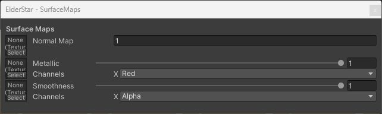<br>
  <sub>Surface Maps</sub>
</p>


<table width="100%">
<thead>
<tr><td colspan="3"><b>Property Name</b></td><td><b>Description</b></td></tr>
</thead>
<tbody>
<tr><td colspan="3"><b>Normal Map</b></td><td>
<p>
Set up the normal map.The specifications of the normal map are as follows.<br>
<ul>
<li>The only normal maps that can be set up are those for tangent space.</li>
<li>If normal map isn't specified, vertex normals are used</li>
<li>The normal scale value can be specified. The default scale is 1.0.</li>
</ul>
For more infomation of the normal map
Please refer to the following URL for details on the normal map.<br>
https://docs.unity3d.com/2021.3/Documentation/Manual/StandardShaderMaterialParameterNormalMap.html
</p>
<tr><td colspan="3"><b>Metallic Map</b></td><td>
<b>It is displayed when the Work Flow Mode is set to Metallic.</b>

Set up the metallic map.The specifications of the metallic map are as follows.<br>
<ul>
<li>If the metallic map isn't set, the value of the metallic property will be used as the uniform metallicity.
<li>If the metallic map is set、the value of the metallic property will be used as multiplier value.</li>
<li>The Channels property allows specifying the channel where the metallic value is stored. Default is R channel.</li>
</ul>
Please refer to the following URL for details on the metallic map.<br>
https://docs.unity3d.com/2018.4/Documentation/Manual/StandardShaderMaterialParameterMetallic.html
</ul>

<tr><td colspan="3"><b>Specular Map</b></td><td>
<b>It is displayed when the Work Flow Mode is set to Specular.</b>

Set up the specular map. The specifications of the specular map are as follows.<br>
<ul>
<li>If the specular map isn't set, the color of specular property will be used as the uniform specular color.</li>
<li>If the specular map is set, the color of specular property will be used as the multiplier color.</li>
</ul>
Please refer to the following URL for details on the specular map.<br>
https://docs.unity3d.com/2018.4/Documentation/Manual/StandardShaderMaterialParameterSpecular.html
</ul>

<tr><td colspan="3"><b>Smoothness Map</b></td><td>
Set up the smoothness map. The specifications of the smoothness map are as follows.<br>
<br>
<ul>
<li>If the smoothness map isn't set, the value of the smoothness property will be used as the uniform smoothess.</li>
<li>If the smoothness map is set, the value of the smoothness property will be used as the multiplier value.</li>
<li>The Channels property allows specifying the channel where the smoothness value is stored. Default is α channel.</li>
</ul>
</tbody>
</table>

<a id="distortion"></a>
## Distortion Shader
Using the Distortion shader, you can apply distortion effects to the screen, such as heat waves.

To use this shader, assign the `Nova/Particles/Distortion` shader to your material. The following is the descriptions of each property that can be set from the Inspector.

#### Render Settings
The Render Settings control how the Material is rendered.


<table width="100%">
<thead>
<tr><td colspan="3"><b>Property Name</b></td><td><b>Description</b></td></tr>
</thead>
<tbody>
<tr><td colspan="3"><b>Render Face</b></td><td>
<p>
You can specify the rendering face from the following options.
</p>
<p>
<ul>
<li>Front (Default)</li>
<li>Back</li>
<li>Both</li>
</ul>
</p>
</td></tr>
<tr><td colspan="3"><b>ZTest</b></td><td>
<p>
You can set ZTest value.
</p>
<p>
<ul>
<li>Disabled</li>
<li>Never</li>
<li>Less</li>
<li>Equal</li>
<li>Less Equal (Default)</li>
<li>Greater</li>
<li>Not Equal</li>
<li>Greater Equal</li>
<li>Always</li>
</ul>
</p>
</td></tr>
</tbody>
</table>

#### Distortion
Distortion controls how it is distorted.

<p align="center">
  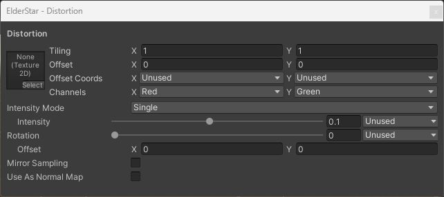<br>
  <sub>Distortion</sub>
</p>


<table width="100%">
<thead>
<tr><td colspan="3"><b>Property Name</b></td><td><b>Description</b></td></tr>
</thead>
<tbody>
<tr><td colspan="3"><b>Texture</b></td><td>
<p>
Sets the Distortion Map. The specifications are as follows.
</p>
<p>
<ul>
    <li>Distorts the screen based on the texture color channels.</li>
    <li>The color channels used is determined by the X value of the Channels Property.</li>
    <li>0.5 is the reference value, and the further away from the reference value, the stronger the distortion.</li>
</ul>
Note that you need to uncheck sRGB Color in the texture import setting because the pixels will be used as values, not colors.
</p>
</td></tr>
<tr><td colspan="3"><b>Intensity Mode</b></td><td>
<p>
Specifies how distortion intensity is controlled.
</p>
<p>
<ul>
<li>Single: Use a single intensity value for both X and Y (Default).</li>
<li>XY: Use separate intensity values for X and Y axes.</li>
</ul>
</p>
</td></tr>
<tr><td colspan=3><b>Intensity</b></td><td>
<p>
<b>This property is visible only when Intensity Mode is set to Single.</b>
</p>
<p>
Sets the distortion intensity.
</p>
</td></tr>
<tr><td colspan=3><b>Intensity X / Intensity Y</b></td><td>
<p>
<b>These properties are visible only when Intensity Mode is set to XY.</b>
</p>
<p>
Sets the distortion intensity for each axis independently.
</p>
</td></tr>
<tr><td colspan="3"><b>Rotation</b></td><td>
<p>
Set the amount of rotation of the Distortion Map.
</p>
</td></tr>
<tr><td></td><td colspan=2><b>Offset</b></td><td>
<p>
Shifts the center coordinate of rotation.
</p>
</td></tr>
<tr><td colspan="3"><b>Mirror Sampling</b></td><td>
<p>
If true, mirrors the texture to create a repeating pattern.
</p>
</td></tr>
<tr><td colspan="3"><b>Use As Normal Map</b></td><td>
<p>
If true, the Texture Type is treated as a Normal Map and will be unpacked for sampling.<br>
Additionally, please specify a normalized Normal Map for the Texture. Otherwise, the rendering results may vary depending on the platform.
</p>
</td></tr>
</tbody>
</table>

#### Flow Mapping
You can use the Flow Map to distort the Distortion Map to the specified directions.

<p align="center">
  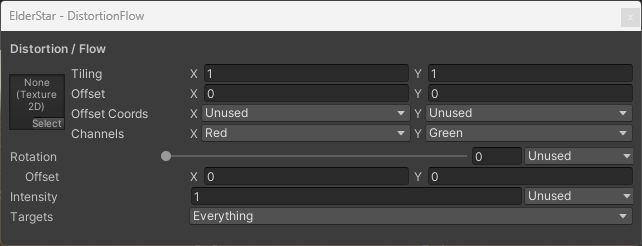<br>
  <sub>Distortion Flow</sub>
</p>


<table width="100%">
<thead>
<tr><td colspan="3"><b>Property Name</b></td><td><b>Description</b></td></tr>
</thead>
<tbody>
<tr><td colspan="3"><b>Texture</b></td><td>
<p>
Sets the Flow Map. The specifications are as follows.
</p>
<p>
<ul>
    <li>Shifts the UV values of the Distortion Map based on the texture color channels.</li>
    <li>The texture color channels used is determined by the X value of the Channels property.</li>
    <li>The smaller the value from 0.5, the more the UV value shifts in the negative direction, and vice versa.</li>
</ul>
Note that you need to uncheck sRGB Color in the texture import setting because the pixels will be used as values, not colors.
</p>
</td></tr>
<tr><td colspan="3"><b>Rotation</b></td><td>
<p>
Set the amount of rotation of the Flow Map.
</p>
</td></tr>
<tr><td></td><td colspan=2><b>Offset</b></td><td>
<p>
Shifts the center coordinate of rotation.
</p>
</td></tr>
<tr><td colspan=3><b>Intensity</b></td><td>
<p>
Sets the Flow Map intensity.
</p>
</td></tr>
</tbody>
</table>

#### Alpha Transition
Alpha Transition controls the alpha value using a texture.

<p align="center">
  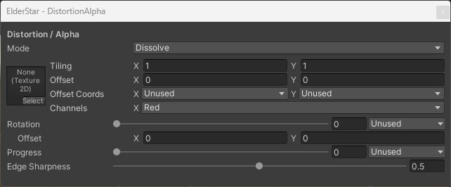<br>
  <sub>Distortion Alpha</sub>
</p>


<table width="100%">
<thead>
<tr><td colspan="3"><b>Property Name</b></td><td><b>Description</b></td></tr>
</thead>
<tbody>
<tr><td colspan="3"><b>Mode</b></td><td>
<p>
You can specify Alpha Transition Mode from the following options.
</p>
<p>
<ul>
<li>None: Don't use the Alpha Transition (Default).</li>
<li>Fade: Transition using the fade texture.</li>
<li>Dissolve: Transition using the dissolve texture.</li>
</ul>
</p>
</td></tr>
<tr><td colspan="3"><b>Texture</b></td><td>
<p>
Sets the Alpha Transition Map. The specifications are as follows.
<ul>
    <li>Changes the alpha value based on the texture color channel.</li>
    <li>The color channels used is determined by the X value of the Channels property.</li>
    <li>The smaller the R value, the easier it is to disappear, and vice versa.</li>
</ul>
</p>
<p>
Note that you need to uncheck sRGB Color in the texture import setting because the pixels will be used as values, not colors.
</p>
</td></tr>
<tr><td colspan="3"><b>Rotation</b></td><td>
<p>
Set the amount of rotation of the Alpha Transition Map.
</p>
</td></tr>
<tr><td></td><td colspan=2><b>Offset</b></td><td>
<p>
Shifts the center coordinate of rotation.
</p>
</td></tr>
<tr><td colspan="3"><b>Progress</b></td><td>
<p>
Sets the progress of Transition.
</p>
</td></tr>
<tr><td colspan="3"><b>Edge Sharpness</b></td><td>
<p>
<b>This property is visible only when the Mode is set to Dissolve.</b>
</p>
<p>
Sets the sharpness of the edge.
</p>
</td></tr>
</tbody>
</table>

#### Transparency
Control the transparency in various ways.

<p align="center">
  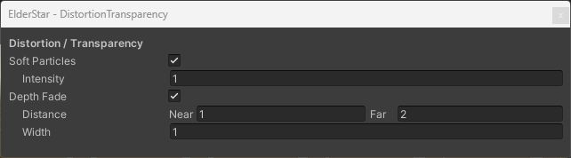<br>
  <sub>Distortion Transparency</sub>
</p>


<table width="100%">
<thead>
<tr><td colspan="3"><b>Property Name</b></td><td><b>Description</b></td></tr>
</thead>
<tbody>
<tr><td colspan="3"><b>Rim</b></td><td>
<p>
If checked, the rim will be transparent.
</p>
</td></tr>
<tr><td></td><td colspan="2"><b>Progress</b></td><td>
<p>
Sets the progress of transparency.
</p>
</td></tr>
<tr><td></td><td colspan="2"><b>Sharpness</b></td><td>
<p>
The larger this value is, the sharper the edge will be.
</p>
</td></tr>
<tr><td></td><td colspan="2"><b>Inverse</b></td><td>
<p>
Inverse the transparency area.
</p>
</td></tr>
<tr><td colspan="3"><b>Luminance</b></td><td>
<p>
If checked, areas with low brightness will be transparent.
</p>
</td></tr>
<tr><td></td><td colspan="2"><b>Progress</b></td><td>
<p>
Sets the progress of transparency.
</p>
</td></tr>
<tr><td></td><td colspan="2"><b>Sharpness</b></td><td>
<p>
The larger this value is, the sharper the edge will be.
</p>
</td></tr>
<tr><td></td><td colspan="2"><b>Inverse</b></td><td>
<p>
Inverse the transparency area.
</p>
</td></tr>
<tr><td colspan="3"><b>Soft Particles</b></td><td>
<p>
If checked, soft particles will be enabled.
This feature requires a camera depth texture. On VRChat avatars, availability depends on the world.
</p>
</td></tr>
<tr><td></td><td colspan="2"><b>Intensity</b></td><td>
<p>
The larger this value, the larger the transparent area.
</p>
</td></tr>
<tr><td colspan="3"><b>Depth Fade</b></td><td>
<p>
Makes the areas near and far from the camera transparent.
This feature uses distance from the camera and does not require a scene depth texture.
</p>
</td></tr>
<tr><td></td><td colspan="2"><b>Distance</b></td><td>
<p>
Set the transparency range.
The area closer than Near and farther than Far from the camera will be transparent.
</p>
</td></tr>
<tr><td></td><td colspan="2"><b>Width</b></td><td>
<p>
The distance from the beginning of transparency to the end of complete transparency.
</p>
</td></tr>
</tbody>
</table>

<a id="ugui"></a>
## Uber Unlit/Lit Shaders for uGUI

Use `Nova/UIParticles/UberUnlit` and `Nova/UIParticles/UberLit` for uGUI.
Their material settings match the regular Uber Unlit/Lit shaders, with support for Mask, RectMask2D and CanvasGroup.
You need a separate mechanism to draw a Particle System on a Canvas.

For Custom Data, enable `TexCoord1` and `TexCoord2` in the Canvas's `Additional Shader Channels`.
Use the x and y components of Custom Coord because uGUI does not retain z and w. Lit also needs Normal and Tangent.

The optional **`ElderStar > Canvas Lighting`** component adds lights to a Canvas.
Use `Collect Scene Lights` to register lights. It selects the most influential Directional, Point and Spot lights and evaluates them in one pass.
The default limit is 4 lights, with a maximum of 8. Source materials, masking and draw order are preserved.

<p align="center">
  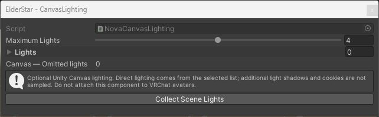<br>
  <sub>Canvas Lighting. An optional helper for regular Unity scenes.</sub>
</p>

This light list does not include shadows or cookies. See [setup and limitations](Documentation~/CanvasLighting.md).
For VRChat avatars, use the allowed mesh and particle rendering paths instead of a real Canvas or this helper script.

<a id="shadow-caster"></a>
## Casting Shadows

Enable **Shadow Caster** on Particle Uber Unlit/Lit to let an effect cast shadows.
Also configure Cast Shadows on the Renderer and Shadows on the Light.

<p align="center">
  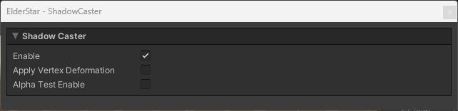<br>
  <sub>Shadow Caster</sub>
</p>

| Property | Description |
| --- | --- |
| Enable | Enables the ShadowCaster pass. |
| Apply Vertex Deformation | Applies vertex deformation to the shadow as well. |
| Alpha Test Enable / Cutoff | Clips the shadow by alpha, using a threshold separate from the color pass. |
| Alpha Affected By | Selects which of Tint Color, Flow Map, Alpha Transition Map and Transparency Luminance affect shadow alpha. |

Shadow resolution, bias and cascades follow Built-in Light / Quality settings.

<a id="custom-data"></a>
## Custom Vertex Streams Integration

Particle System Custom Data can vary material values per particle and animate them over each particle's lifetime.
Both regular particle and trail streams are supported. The following example animates texture rotation.

### Configure Custom Data

Enable the Particle System's `Custom Data` module and set `Custom1` to Vector.
Set the X curve to start at 0 and end at 1 over the particle's lifetime.

### Configure Custom Vertex Streams

Enable `Custom Vertex Streams` in the Renderer.
Alongside Position, Normal, Color and UV, add **UV2** to fill `TEXCOORD0.zw` before Custom1.
Check the stream list to confirm that `Custom1.x` is assigned to `TEXCOORD1.x`.
The layout depends on the render mode; [Fix Now](#fix-now) is the easiest way to configure it.

### Configure the material

Select **COORD 1X** from the Custom Coord selector beside Base Map's `Rotation`.
Each particle's Custom1.x now drives its rotation.
Other properties with a Custom Coord selector, including Progress, Intensity and UV Offset, work the same way.

For Flip Book's Random Row Selection, set Row Count to the number of rows.
Configure another Custom Data component as `Random Between Two Constants` from 0 to Row Count, and assign it to Random Coord.

<a id="gpu-instancing"></a>
## Using Mesh GPU Instancing

In the Particle System Renderer, set `Render Mode = Mesh` and enable `Enable Mesh GPU Instancing`.
Enable GPU Instancing on the material too. Shader Model 4.5 support is required.

Custom Vertex Streams must fill `INSTANCED1.xyzw` and `INSTANCED2.xyzw` completely.
Fix Now configures a typical layout using Custom1 and Custom2. Check the displayed assignments when using custom layouts.

See [Unity's Particle System GPU Instancing documentation](https://docs.unity3d.com/2022.3/Documentation/Manual/PartSysInstancing.html).

<a id="fix-now"></a>
## Automatic Custom Vertex Streams Setup

If a Renderer's streams differ from those required by its material, a warning and **Fix Now** appear at the bottom of the Inspector.
Click it to configure the required standard layout on Renderers using that material.
Both the regular material and Trail Material are checked. Try this before configuring the streams manually.

<a id="unused-references"></a>
## Removing Unused References

After switching to Single Texture, a material can still reference an unused Texture2DArray or another texture.
These references can cause unnecessary assets to be included in a build.

Select the materials in the Project window and run **`Tools > ElderStar > RemoveUnusedReferences`**.
Removed references are listed in the Console. Reassign a texture if you later switch back to a mode that needs it.

<a id="optimization"></a>
## Reducing Memory Usage with Optimized Shaders

Uber shaders contain many keywords and passes.
Generate shaders limited to the Render Type and passes you need, then replace material shaders to reduce unnecessary variants.
Savings depend on the features, platform and build settings in use.

| API | Description |
| --- | --- |
| `OptimizedShaderGenerator.Generate(outputFolderPath)` | Generates optimized Particle Uber Lit/Unlit shaders. |
| `OptimizedShaderReplacer.Replace(settings)` | Replaces materials in the specified folder with matching optimized shaders. |

### Generate and apply

Use the following Editor APIs, generating shaders before replacing material references.
Place the script in an `Editor` folder and set the target folders before running the menu.

```csharp
using Nova.Editor.Core.Scripts.Optimizer;
using UnityEditor;

public static class EffectShaderOptimization
{
    [MenuItem("Tools/My Effects/Optimize")]
    public static void Run()
    {
        OptimizedShaderGenerator.Generate("Assets/ElderStarOptimized");
        OptimizedShaderReplacer.Replace(new OptimizedShaderReplacer.Settings
        {
            TargetFolderPath = "Assets/MyEffects/Materials",
            OpaqueRequiredPasses = OptionalShaderPass.ShadowCaster,
            CutoutRequiredPasses = OptionalShaderPass.ShadowCaster,
            TransparentRequiredPasses = OptionalShaderPass.None
        });
    }
}
```

Adjust the output and target folders to your project.
Built-in also uses ShadowCaster for camera depth generation, so that pass may be needed even when you do not display shadows.
Keep DepthNormals if you use its output. UI and Distortion shaders are not included in this generator.
See the [Editor API reference](Documentation~/EditorAPI.md) for details.

<a id="builtin-helpers"></a>
## Built-in Helpers

Regular Unity projects can optionally use the following helpers.
None is required for basic rendering on VRChat avatars.

| Feature | Purpose |
| --- | --- |
| [Screen Space Distortion](Documentation~/BuiltInRenderingAPI.md) | Composes distortion for a mono camera. Also exposes Camera, CommandBuffer and RenderTexture APIs. |
| [Canvas Lighting](Documentation~/CanvasLighting.md) | Evaluates up to 8 lights in a single pass on regular Canvases. |
| [DepthNormals](Documentation~/DepthNormals.md) | Outputs NOVA objects' normals and coverage to a dedicated texture, leaving the world's depth-normal texture intact. |
| [Ambient Lighting](Documentation~/AmbientLighting.md) | Supplies local Light Probe lighting separately from the ambient input used for global environment reflections. |
| [LPPV and Rendering Diagnostics](Documentation~/ProbeVolumesAndDiagnostics.md) | Spatial indirect lighting and 8 Editor views, including albedo, normals, depth and lighting. |

<a id="compatibility"></a>
## Compatibility and Verification

NOVA 3.6.0's standard shader names, material properties, GUIDs and public Editor APIs are preserved.
Material editing and effect authoring follow the original workflow.
Using Built-in introduces the following differences.

| Area | ElderStar behavior |
| --- | --- |
| Lights, shadows and ambient lighting | Uses Built-in lights, shadows and probes. Scene inputs can change the appearance of the same material. |
| Overlapping distortion | The shader-only path samples the background per surface. It does not accumulate multiple nonzero distortions in the same way as URP. Regular Unity projects can use camera composition. |
| Soft Particles | Requires a camera depth texture. A VRChat avatar cannot force the world's depth settings. |
| Transparent draw order | Ordering may differ when depth and sorting conditions are equal. Set Renderer Sorting Order explicitly when needed. |
| Forward+ / APV | Uses Built-in additional lights and LPPV as substitutes. This is not a compatible implementation of URP tiling or the APV data format. |
| URP-only C# APIs | Code using Renderer Features, RenderGraph and similar APIs needs a Built-in implementation. This is separate from importing material assets directly. |

Editor behavior, rendering, image comparisons and package installation have been checked in Unity 2022.3 and Unity 6.
VRChat PC SDK builds and rendering after AAO optimization with default settings have also been tested. This does not guarantee identical results for every avatar, world or GPU.
Physical PCVR testing and in-client checks incorporating the latest changes remain ongoing verification items.

See the [compatibility matrix](Documentation~/Compatibility.md) for feature-specific conditions and the [repository verification documentation](https://github.com/smizuoch/ElderStar/blob/main/Documentation/Verification.md) for recorded results.

<a id="editor-api"></a>
## Editor API Reference

The [Editor API guide](Documentation~/EditorAPI.md) covers RendererErrorHandler, OptimizedShaderGenerator and OptimizedShaderReplacer.
Namespaces such as `Nova.Editor.Core.Scripts` retain their original names for compatibility with existing code.

<a id="license"></a>
## License

ElderStar is available under the [MIT License](LICENSE.md).
It is an independent Built-in port of NOVA Shader and is not an official CyberAgent product.

Original shaders, Editor code and feature reference:
[NOVA Shader / CyberAgent, Inc.](https://github.com/CyberAgentGameEntertainment/NovaShader)
(Copyright 2021 CyberAgent, Inc.). The feature tables and explanations in this README are adapted from that project's MIT-licensed documentation.
See [image credits and capture conditions](Documentation~/Images/README.md) for the example assets.
When importing other assets, also follow their respective licenses.
