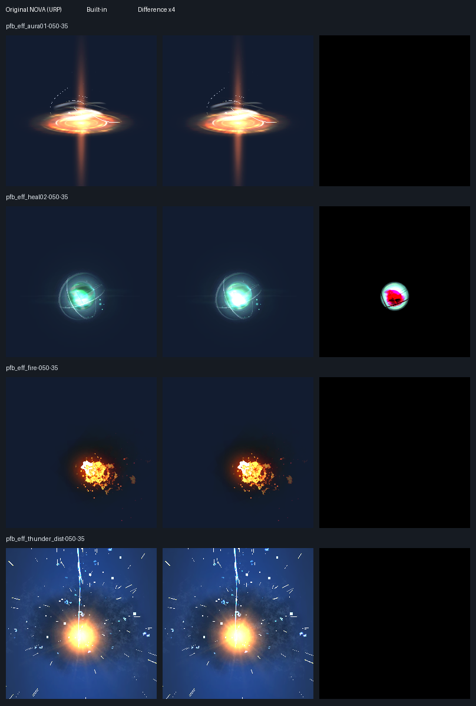

# 0.1.2 initial settings and licensed asset verification

Date: 2026-10-12. NOVA reference: 3.6.0, commit
`1c6b88729f91c852c164ef71a32cc2bce83a1892`.

The ordinary editor/rendering suites pass, and the additional corpus identifies
one remaining visual difference: tied transparent renderers in `pfb_eff_heal02`.
**This is not a claim of complete pixel compatibility for every asset.** The
expanded strict comparator intentionally reports failure for that effect; neither
its thresholds nor any existing golden image has been changed.

## Changes delivered

- First Built-in import and color-space changes apply the original light intensity
  and color-temperature defaults. Project-local opt-out and later manual edits are
  preserved. Only GraphicsSettings is saved; unrelated dirty assets remain unsaved.
- Raw new materials use the original queue 2000 and preview/projector/performance
  tags. Original Inspector validation applies the selected transparent queue.
- All four Uber shaders now apply Base Map rotation/pivot before tiling/offset,
  followed by Custom Data offsets, including applicable depth/shadow paths.
- Lit depth/shadow passes use the selected 2D Array/3D transform, Custom Data
  flipbook progress and random-row selection instead of ignoring those controls.

Implementation files are under `Assets/Nova/Editor/Core/Scripts`,
`Assets/Nova/Runtime/Core/Shaders` and its `BuiltIn` includes. Tests are in
`Assets/Tests/Editor`, `Assets/Tests/PlayMode` and `Tests/Visual`.
The main changed files are `BuiltInLightingSettings.cs`, `BuiltInProjectSettings.cs`,
`NovaBuiltInBaseUV.cginc`, `NovaBuiltInParticleFeatures.cginc`,
`ParticlesUberUnlit.shader`, `ParticlesUberLit.shader`, `UIParticlesUberUnlit.shader`,
`UIParticlesUberLit.shader`, `ParticlesDistortion.shader` and the five compatibility
alias shaders. UI Lit also consumes the shared include.
Original shader/property names, GUIDs and editor API declarations remain intact.

TDD evidence: 24 UV cases, four Lit transform cases, eight custom flipbook cases,
nine initial-tag cases and the unrelated-save regression failed before their fixes.
All now pass. The Canvas mask fixture explicitly creates an authored transparent
material; raw-material defaults have separate parity coverage.

## Licensed inputs and import behavior

- [Official NOVA samples](https://github.com/CyberAgentGameEntertainment/NovaShader/tree/1c6b88729f91c852c164ef71a32cc2bce83a1892/Assets/Samples):
  MIT, 570 source files, 13 effect prefabs and 110 material files. The NOVA copyright
  and license accompany the rendered comparison in [NOVA-LICENSE.txt](Validation/AssetCorpus/NOVA-LICENSE.txt).
- [Kenney Particle Pack](https://kenney.nl/assets/particle-pack): CC0. The pinned
  archive identifies itself as Particle Pack 1.1 and contains 96 transparent PNGs;
  the site's advertised count differs from the downloaded archive. All 96 are tested.
  The archive's [license notice](Validation/AssetCorpus/KENNEY-LICENSE.txt) is retained.

[Source hashes](Validation/AssetCorpus/sources.json) pin the sample files and
downloaded archive. External source assets are kept outside the distributable
package. No purchase, manual material migration or shader reassignment was used.

All 13 effect prefab files remain byte-identical in all four isolated projects.
Unity's normal import/test startup serializes older material defaults: 96 materials
in the Unity 6 pair, 100 in the 2022 pair; the URP 2022 importer also adds its light
component to the separate `Point Light.prefab`, which is not one of the 13 tested
effects. [Post-import hashes](Validation/AssetCorpus/post-import.json) record this
explicitly. Therefore “no conversion step” does not mean Unity never reserializes
an old asset. The original repository files themselves were not edited.

The test loads prefabs into a controlled scene. Original URP demo scenes and their
pipeline-specific components are not covered by this acceptance.

## Expanded visual comparison

Both editors use Windows Direct3D11, 256 x 256 normal game-camera captures, no
bloom/color grading, and matching ambient/directional-light inputs. Reference versions
are URP 14.0.10 on 2022.3.22f1 and URP 17.3.0 on 6000.3.23f1. The Built-in projects
contain no URP/Core packages and assert automatic initial lighting settings.

Each run includes 96 textures on four shaders, eight fresh/validated material
captures, and each effect at 0.15/0.5/1.2 seconds from 0/35/80 degrees. Only runtime
particle seeds are fixed. No material setup is applied manually to imported effects.
The texture backdrop is brighter than the effect backdrop so low-alpha black Lit
output remains visible; the same scene settings are used on both sides.

| Editor / color space | Within threshold | Pixel-identical | Identical state snapshots |
| --- | ---: | ---: | ---: |
| 2022 / Gamma | 503 / 509 | 502 | 47 |
| 2022 / Linear | 503 / 509 | 493 | 47 |
| Unity 6 / Gamma | 494 / 500 | 492 | 44 |
| Unity 6 / Linear | 494 / 500 | 485 | 44 |

All 1,536 CC0 texture comparisons and all 32 fresh/validated material captures pass.
The same six heal02 frames fail in each run, totaling 24 failures among 2,018
comparisons. Particle and initial material states match in every run. Visibility,
inventory and shader diagnostics are also checked. Thresholds remain mean RGB error
<= 0.01, maximum channel error <= 0.08, and <= 1% pixels with mean RGB error > 0.02.

Metrics: [2022 Gamma](Validation/AssetCorpus/unity2022-gamma.json),
[2022 Linear](Validation/AssetCorpus/unity2022-linear.json),
[Unity 6 Gamma](Validation/AssetCorpus/unity6-gamma.json),
[Unity 6 Linear](Validation/AssetCorpus/unity6-linear.json).

### Transparent overlap

heal02 has multiple transparent renderers with equal bounds centers, queue and
sorting order. Each renderer captured alone matches exactly, but their combined
image differs between pipelines. Perspective/orthographic transparency-sort modes
do not remove the difference. This isolates compositing order rather than shader
surface math. It is categorized as Approximate in the compatibility matrix.

The explicit fallback assigns distinct `ParticleSystemRenderer.sortingOrder`
values in hierarchy order on instantiated objects in both pipelines. All 18
Gamma/Linear fallback frames are pixel-identical, with six matching particle states:
[fallback metrics](Validation/AssetCorpus/sort-fallback.json). This changes authored
ordering and is not silently applied during import. It does not prove the port's
default image equals the original default image.

### Unity 6 native crash

The official `pfb_eff_fire` crashes both original NOVA/URP and the Built-in port on
6000.3.23f1 at `ParticleSystemRenderer::PrepareForRender`, with
`ParticleSystemGeometryJob::ScheduleJobs` in the native stack. The Unity 6 capture
explicitly excludes this one effect and requires an exclusion marker; Unity
2022.3.22f1 renders all 13. This is different from the supplied N2Studio `Fire001`.

Unity documents a [similar native particle-renderer issue, UUM-127537](https://issuetracker.unity.com/issues/16930/crash-on-particlesystemrendererprepareforrender-when-interacting-with-a-specific-prefab-in-a-scene).
The matching stack is supporting context, not proof that the root causes are
identical. Use the verified 2022.3.22f1 editor for this official prefab; another
editor version needs its own validation.

## Release checks and remaining scope

| Check | Unity 2022.3.22f1 | Unity 6000.3.23f1 |
| --- | ---: | ---: |
| Full EditMode, including compiler diagnostics | 442 / 442 | 442 / 442 |
| Full graphics PlayMode | 807 / 807 | 807 / 807 |
| Installed 0.1.2 tarball checks | 16 / 16 | 16 / 16 |
| Installed Fire001 captures, Gamma + Linear | 36 rendered | 36 rendered |

The installed package checks include six shader names, 48 optimized shader outputs,
sample import, original/legacy GUID references, real effect import, and initial
lighting persistence/Undo/save scope. Neither package project depends on URP.
Four documentation tests, four original-contract tests, thirteen visual comparator
tests, two shell-runner tests and the shell environment regression pass.

The supplied Fire001 was separately rechecked against its own bundled original NOVA
on Unity 6: all 36 Gamma/Linear frames are pixel-identical and all particle states
match. Its nine source effect files remain unchanged in both installed-package
projects. See [Gamma](Validation/AssetCorpus/fire001-gamma.json) and
[Linear](Validation/AssetCorpus/fire001-linear.json). This does not validate its URP
demo scene or extend the claim to arbitrary unitypackages.

The final tarball also built a Windows x64 Fire001 player on Unity 6000.3.23f1.
The build succeeded and the executable exited 0 on Direct3D11, with six particle
systems, five enabled renderers and 4,726 visible fire pixels. The actual frame was
inspected and the player log contains no shader/runtime errors. See
[player result](Validation/AssetCorpus/player.txt). This standalone recheck is Unity
6 only; Unity 2022 is covered by the full graphics suite and installed effect captures.

Local delivery: [jp.co.cyberagent.nova.builtin-0.1.2.tgz](../Builds/Release/jp.co.cyberagent.nova.builtin-0.1.2.tgz),
162,096 bytes, 216 files matching package source byte-for-byte. SHA-256:
`03e982ac25b232aeb751e98c6bbfd6063b6c0616e84f077409691c705bc6f8bc`.
It was created with `PackageManager.Client.Pack` and installed in both isolated
projects. Build artifacts remain local/ignored; source, metrics and reproduction
fixtures are committed.

Final package/player results and archive hashes are recorded in
[release metadata](Validation/AssetCorpus/release.json). Reproduction commands and
strict/fallback distinctions are in [Tests/Visual](../Tests/Visual/README.md).

URP-specific lighting assignment, depth conventions, unsupported renderer features,
and tied transparent sorting remain subject to the
[compatibility matrix](BuiltInCompatibilityMatrix.md). Next work is broader
artist-material combinations/platform coverage and rechecking the native Unity 6
fault when a suitable editor fix is available. Existing baselines remain unchanged.
