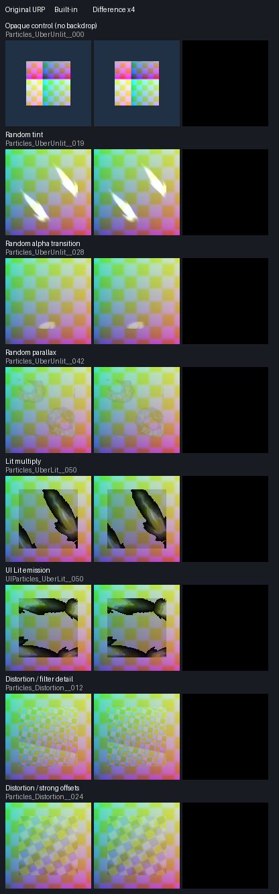

# Randomized API and rendering verification (2026-10-13)

This audit covers the NOVA 3.6.0 public editor contract, the 66 documented feature
rows, and new randomized material combinations. All **3,328 comparisons pass the unchanged
image thresholds**; 2,874 are pixel-identical. This is finite tested coverage, not
universal pixel identity. Forced camera-distortion anisotropy is an 8x approximation
of the original forced 9x, and URP integration APIs are not source-compatible.

## Inputs and coverage

- Original: `CyberAgentGameEntertainment/NovaShader` commit
  `1c6b88729f91c852c164ef71a32cc2bce83a1892`, MIT. Unity 2022.3.22f1 uses
  URP 14.0.10; Unity 6000.3.23f1 uses URP 17.3.0. The original shader sources are
  unchanged. Unity-version guards on the isolated 2022 reference C# renderer
  integration allow the original pre-RenderGraph path to compile.
- Textures: all 96 CC0 Kenney Particle Pack 1.1 PNGs from the pinned
  [licensed corpus](Validation/AssetCorpus/sources.json). No paid/avatar assets are
  added to the repository. Array/volume resources derive from the same corpus.
- Seed `20261013 + sample`: 96 configurations for each of the four Uber shaders,
  plus 32 distortion configurations = 416 comparisons per editor/color space/
  anisotropy setting. Both ForceEnable and Disable are compared.
  The same chosen textures, property values, transforms, keywords, mesh Custom
  Data and vertex colors are compared before accepting any rendered comparison.
- Twelve Uber profiles exercise maps/channels/UVs, tones, tint/rim, alpha/second
  transitions, flow, parallax, emission, color correction, transparency, depth/
  deformation and combinations. Lit uses a diffuse dielectric to isolate the
  shared material stack. The full regression suite separately covers normal and
  surface maps, GGX, reflections, shadow/depth passes, UI, instancing and stereo.
- Random dissolve/transparency combinations can intentionally hide a particle;
  those frames alone do not prove a feature works. Visible controls omit the
  backdrop, and differential witnesses require soft particles and distortion to
  visibly affect pixels. Dedicated feature tests remain required.
- [API/feature inventory](Verification/ApiFeatureCoverage20261013.json): all
  **525 public/protected editor declarations**, **21 declared runtime API entries**
  (15 on Unity 2022, 21 on Unity 6), all **889 ShaderLab property
  declarations**, and **66 compatibility rows**. Declaration tests do not imply
  exhaustive behavioral/input coverage for every method. Each entry identifies
  the evidence and its scope.
- New original/port API execution: **188 identical results per editor** from all
  10 keyword lookup overloads (every enum value plus invalid values), 128 seeded
  unused-texture cleanup cases, and 8 particle/trail stream repairs. Cleanup and
  stream fixes also have idempotence assertions. Existing tests cover material
  state transitions, Inspectors, Undo, shader reassignment, optimizer generation
  and replacement.

## Fixes reproduced before implementation

1. Lit multiply blending modulated the final lit result. Original NOVA modulates
   albedo before lighting. The original alpha-zero behavior therefore also
   receives lighting. Two of four targeted cases failed before the fix.
2. Random-row flipbook progress was clamped before row normalization. Custom Data
   can push progress below zero or above one; clamping must follow the original
   row calculation. Two targeted boundary cases failed before the fix.
3. Back-facing parallax discarded the sign of `view.z + 0.42`. Its offset now
   retains that sign. One targeted GPU case failed before the fix. The existing
   small-denominator safety guard remains an explicitly documented approximation.
4. Unity 6 camera-depth sampling used the texture's sampler instead of URP 17's
   PointClamp alias. Two boundary samples failed before the fix; the graphics
   math/stereo suite then passed 22/22 cases. Unity 2022 retains URP 14 sampling.

5. The pipeline-independent public `DeprecationMessage` type and its warning
   constant were missing. A reflection/value test failed, then passed after
   restoring the original declarations verbatim. Both final EditMode suites
   contain this regression. The runtime inventory gives every declaration its
   own preserved/approximate/pipeline-specific disposition.

The original Unity 6 reference initially copied depth after transparent rendering,
so its soft particles did nothing. A new visible-effect assertion failed (zero
changed pixels). Setting the reference renderer to `AfterOpaques` and requiring
camera depth made that assertion pass. This was a fixture correction, not a
product fix. Earlier captures with absent reference depth are excluded from final
acceptance. See Unity's [Universal Renderer depth-copy documentation](https://docs.unity3d.com/ja/6000.0/Manual/urp/urp-universal-renderer.html).

## Camera compositor follow-up

The camera compositor did not reproduce the original forced-anisotropy response
around rapidly varying distortion. It now selects an explicit 8x sampler only
for `QualitySettings.anisotropicFiltering == ForceEnable`; Disable and per-texture
settings retain ordinary sampling. The 38 failing comparisons (13 Linear and
6 Gamma per editor) passed after this change. Unity rejects inline Aniso9 and
supports 2/4/8/16, so the nearest supported 8x value is documented as Approximate.
This changes neither the project quality setting nor the effect's materials.

## Results

The machine-readable metrics, API observations, input hashes and test summary are
stored under [Verification/Randomized20261013](Verification/Randomized20261013/summary.json).
Both editors pass **448/448 EditMode** and **852/852 graphics PlayMode** tests,
including shader diagnostics. No existing golden image or threshold was changed.

| Editor | Color space | Anisotropy | Compared | Passed | Pixel-identical |
| --- | --- | --- | ---: | ---: | ---: |
| 2022.3.22f1 | Linear | ForceEnable | 416 | 416 | 361 |
| 2022.3.22f1 | Gamma | ForceEnable | 416 | 416 | 352 |
| 2022.3.22f1 | Linear | Disable | 416 | 416 | 368 |
| 2022.3.22f1 | Gamma | Disable | 416 | 416 | 356 |
| 6000.3.23f1 | Linear | ForceEnable | 416 | 416 | 361 |
| 6000.3.23f1 | Gamma | ForceEnable | 416 | 416 | 352 |
| 6000.3.23f1 | Linear | Disable | 416 | 416 | 368 |
| 6000.3.23f1 | Gamma | Disable | 416 | 416 | 356 |

All **3,072 Uber and 256 camera-distortion comparisons** pass, with **3,328 identical
material input states**. The remaining 454 nonidentical images are within the
unchanged mean RGB <= 0.01, maximum channel <= 0.08 and bad-pixel fraction <= 0.01
thresholds. These are bounded Windows D3D11 checks, not certification for arbitrary
inputs, every GPU, or physical PCVR. API observations and red/green metrics remain
available alongside the final metrics; failed earlier runs are not erased.

Diagnostic captures found identical pre-composite RGB backgrounds in all 32
cases. The raw offset probe matched bit-for-bit in 31/32 cases; its other case
varied by one half-float quantum in one channel/pixel. Actual camera offset buffers
also expose small raster/depth/interpolation rounding differences. Disabling
anisotropy in the original changed its edge response; explicit 8x sampling brought
the final comparator within tolerance on both editors and in both color spaces.
Unity documents [forced texture anisotropy](https://docs.unity3d.com/ja/2020.3/ScriptReference/Texture-anisoLevel.html)
and [supported inline sampler counts](https://docs.unity3d.com/jp/2020.3/Manual/SL-SamplerStates.html).
No diagnostic source copy, procedural blit, global quality override, or altered
original shader is shipped. The reference shader sources match the pinned original bytes.
Both port imports received the same automatic Unity GLES2-exclusion annotation
in `NovaBuiltInParticleInstancing.cginc`; the source/imported hashes and exact two
added lines are recorded. This does not affect the tested D3D11 path.

Camera distortion remains **Approximate** because 8x is not 9x and the two pipelines
can differ in raster/depth rounding and scheduling. Leave anisotropy disabled if
that is the desired quality setting; the tested disabled path also passes. This
is not a promise of pixel identity or an automatic material conversion. URP
`ScriptableRendererFeature`, `ScriptableRenderPass` and RenderGraph entry points
remain pipeline-specific; Built-in supplies a camera component/shader path.
The previous VRC/AAO acceptance is retained for 0.1.3; this audit does not represent
another server upload, physical-headset run, or new AAO configuration test.

Next TODO: broaden the finite cases to additional GPUs/graphics APIs and physical
PCVR; revisit exact 9x compositor sampling if Unity exposes a practical portable path.
Reproduction commands and diagnostic subset limits are in
[Tests/Visual/README.md](../Tests/Visual/README.md#seeded-material-and-public-api-comparison).

## Changed files and checks

Product changes are in `NovaBuiltInParticleFeatures.cginc`,
`NovaBuiltInUberUnlit.cginc`, `NovaBuiltInDepth.cginc`,
`ParticlesApplyDistortion.shader`, `ScreenSpaceDistortion.cs`, and the restored
`DeprecationMessage.cs`. Focused regression tests accompany the math, Lit and
public-constant changes. `Tests/Visual/NovaRandomizedCapture.cs` supplies the
camera-compositor regression and quality-setting comparisons; the other new
fixtures export public API observations and guard comparison validity.

Both full EditMode/PlayMode suites, all 16 capture runs, four final API runs and
all eight image comparisons pass. Python contract, documentation and comparator
tests also pass. The original golden images remain unchanged. Existing licensed
sample sort-tie/native-crash limits remain recorded in
[AssetCorpusVerification.md](AssetCorpusVerification.md); this audit does not
supersede those separate asset reports.
