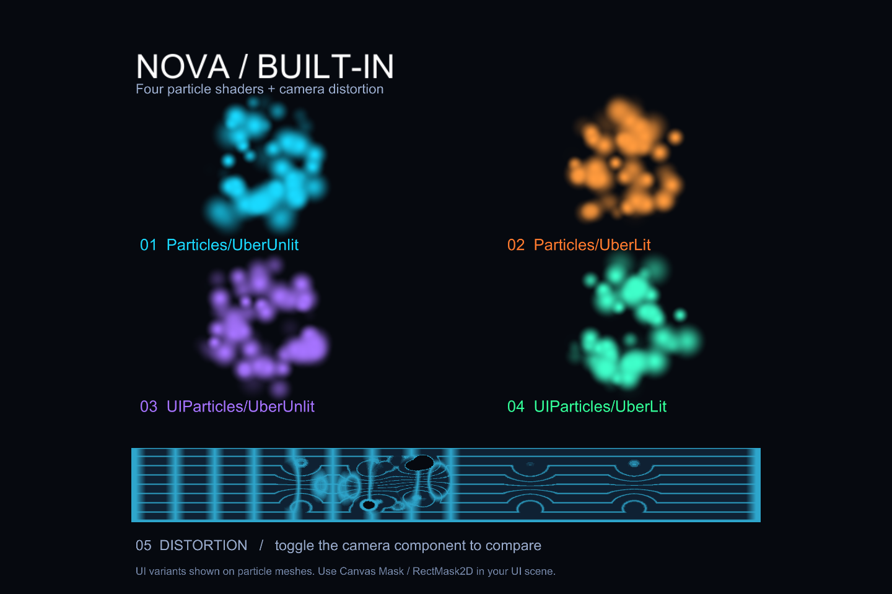

# NovaShaderBuilt-in

A Built-in Render Pipeline port of [CyberAgent NOVA Shader](https://github.com/CyberAgentGameEntertainment/NovaShader) 3.6.0.
The six original shader names, material properties and custom editor APIs are retained.
No URP, SRP Core or RenderGraph package is required. This is an independent port,
not an official CyberAgent release. Original code remains under the MIT license.

## Install

Use Unity 2022.3 or Unity 6 with Built-in Rendering. The tested versions are
2022.3.22f1 and 6000.3.23f1 on Windows, using Direct3D11/12.
Clear the Render Pipeline Asset in Graphics and in every Quality level.

In Package Manager, choose **Add package from disk** and select
`Assets/Nova/package.json` from this checkout. A packed `.tgz` can instead be
installed with **Add package from tarball**. To install a Git revision, use the
repository URL with `?path=/Assets/Nova` and an explicit commit or release tag.
Do not install this package alongside original NOVA: their public names deliberately match.

## Run the sample

Import **Built-in Showcase** from the package's Samples section, open
`NovaShowcase.unity`, then press Play. The scene contains four colored particle
systems and moving distortion over a grid. Toggle **Screen Space Distortion** on
the camera to compare. The UI variants are demonstrated on particle meshes;
Canvas `Mask` and `RectMask2D` behavior is covered separately by rendering tests.

For an editable scene generated in a folder of your choice, use
**Tools > NOVA > Built-in > Create Showcase Scene**. Save an untitled scene first
when Unity prompts. Generation keeps the active scene and refuses to overwrite
existing scenes or sample assets.

## Materials and cameras

Select one of the original names in a material's Shader menu:

- `Nova/Particles/UberUnlit`
- `Nova/Particles/UberLit`
- `Nova/UIParticles/UberUnlit`
- `Nova/UIParticles/UberLit`
- `Nova/Particles/Distortion`

`Hidden/Nova/Particles/ApplyDistortion` is retained automatically for the camera effect.
Use the NOVA Inspector to configure material keywords and particle vertex streams.
Enable a camera's `DepthTextureMode.Depth` for soft particles. Distance-based depth
fade does not need scene depth. Distortion uses a named GrabPass automatically,
so PC VRChat avatars need no NOVA camera component. For ordinary mono projects,
**NOVA > Screen Space Distortion** optionally provides the accumulated camera
compositor and enables depth. Put that component before other image effects.

Original NOVA materials now work without conversion: all six original shader GUIDs
are preserved. For an effect package such as **Fire001.unitypackage**, use
**Assets > Import Package > NOVA Effect...**, select the original file, Import,
and drag the prefab into a scene. The importer omits bundled original NOVA source
and keeps effect assets unchanged. With ordinary Unity import, deselect that
bundled source folder to avoid importing conflicting URP code. See
[import instructions](Documentation/Migration.md) and
[Fire001 verification](Documentation/DirectImportVerification.md).

On first import (and after changing color space), NOVA automatically matches the
original light intensity/color-temperature settings for the entire project.
Later manual lighting edits survive reloads. The project-local **Tools > NOVA >
Built-in > Automatic Initial Lighting Setup** toggle disables this behavior;
**Match Original Lighting Settings** remains available with Undo support.

The original optimizer APIs remain available:
`OptimizedShaderGenerator.Generate("Assets/NovaOptimized")` and
`OptimizedShaderReplacer.Replace(settings)` in `Nova.Editor.Core.Scripts.Optimizer`.
Generate before replacing, and choose the material folder explicitly. Replacing
materials preserves their properties, keywords and queue and supports Undo.

## Compatibility and verification

The [randomized API/feature audit](Documentation/RandomizedParityVerification.md)
adds six reproduced fixes and 3,328 original/port comparisons, all within the
unchanged thresholds (2,874 pixel-identical). Forced distortion filtering retains
a documented 8x/9x approximation.
Both editors pass 448 EditMode and 852 graphics PlayMode tests. The report
separates preserved declarations, exercised API behavior and remaining limits.

The [0.1.2 settings and asset report](Documentation/AssetCorpusVerification.md)
records initial-state parity, 442 EditMode and 807 PlayMode tests per editor, plus
MIT/CC0 asset comparisons. The expanded corpus exposes a remaining transparent-sort
tie and a Unity 6 native sample crash; it is not a universal pixel-parity pass.
The [0.1.1 direct-import report](Documentation/DirectImportVerification.md) retains
the original unchanged Fire001 input/import and 36-frame comparison evidence.
The [previous 0.1.0 report](Documentation/VerificationReport.md) retains the broader
336 controlled comparisons and showcase player evidence.

Lit shading preserves the original GGX and environment Fresnel/roughness response
with normal, metallic/specular and smoothness maps. Light scheduling, shadows and
probe assignment use Built-in; URP Forward+ and probe volumes have no equivalent.
CanvasRenderer additional lighting and camera distortion have documented limits.
Texture arrays/3D textures require suitable hardware; untested graphics APIs are
not certified by the Windows verification results.

See the [feature compatibility matrix](Documentation/BuiltInCompatibilityMatrix.md),
[verification commands](Documentation/Verification.md) and
[controlled visual comparison](Tests/Visual/README.md). Tests include shader diagnostics,
real camera/particle/Canvas rendering, migration, optimization, isolated UPM import
and standalone players. Existing golden images are never rewritten by these tools.

The [PC avatar and AAO report](Documentation/VRChatPCVerification.md) records SDK
3.10.5 bundle rendering, AAO 1.9.20 default optimization and the 0.1.3 stereo fixes.
